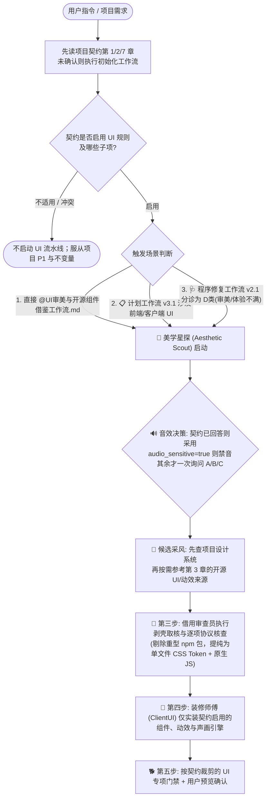

# 通用工业级 UI 审美、微交互与开源组件借鉴工作流规范 (UI Aesthetics, Motion & Harvest Constitution)

> **文档代码**：`UI_AESTHETICS_WORKFLOW.md` / `UI审美与开源组件借鉴工作流.md`  
> **版本**：`v1.1-Project-Aware`（与 [`计划工作流.md`](./计划工作流.md) `v3.1`、[`程序修复工作流.md`](./程序修复工作流.md) `v2.1` 组成三位一体工作流体系；共用 [`项目适配与契约初始化工作流.md`](./项目适配与契约初始化工作流.md) 与 [`项目契约模板.md`](./项目契约模板.md)）  
> **适用范围**：所有包含前端界面（Web / React / Vue / 原生 HTML+CSS / 桌面端 Electron & Tauri / 移动端）的新项目开发、界面美化升级、按钮与微交互改造、以及按需开启的沉浸式声画同步设计。  
> **设计核心目标**：
>
> 1. **提供可裁剪的审美能力库**：建立 **🔭 美学星探（UI与开源标杆研究员）**，先读契约和项目现有设计系统，再按需从第 3 章候选来源提取轻量 UI/动效片段。
> 2. **极致轻量化且即拷即跑**：严守“剥壳取核”法则——能用 30 行原生 CSS 变量与 GPU 合成层动画（`transform`/`opacity`）解决的，绝不引入几百 KB 的重型 JS 动画包。
> 3. **铁面按钮与微交互出厂标准**：明确限定 5 类标准按钮与 6 种必做微交互状态（悬浮流光、按压回弹 `scale(0.97)`、防连点内联加载、危险操作长按充能、弹簧拨片、错误抖动）。
> 4. **音效严格“按需可插拔（Opt-In Only）”**：项目契约已经回答时直接采用；契约未回答且 `audio_sensitive=false` 时，才一次询问用户；`audio_sensitive=true` 时直接禁音。经用户开启时采用零外部音频文件的 Web Audio API 合成器。

> [!IMPORTANT]
> 本文件是**候选 UI 能力库与裁剪规则**，不是凌驾于项目第一要义之上的强制审美宪法。唤醒本文件前必须先执行 [`@项目适配与契约初始化工作流.md`](./项目适配与契约初始化工作流.md)，读取契约第 1、2、7 章。契约若声明 `ui_contract_enabled=false`，不进入 UI 流水线；若声明部分启用，只执行与契约质量排序兼容的条目。组件、按钮、动效、音效与 UI-Gate 均不得损害项目 P1 或契约第 3 章“必须保持的行为”。

---

## 目录 (Table of Contents)

1. [最高审美宪法与三工作流协同路由 (Constitutional UI Charter & Tri-Workflow Routing)](#1-最高审美宪法与三工作流协同路由-constitutional-ui-charter--tri-workflow-routing)
2. [角色定义：🔭 美学星探与前端协同流水线 (The Aesthetic Scout & Taskforce)](#2-角色定义-美学星探与前端协同流水线-the-aesthetic-scout--taskforce)
3. [八大开源 UI 与动态交互借鉴源宝库 (The 8 Curated UI & Motion Harvesters)](#3-八大开源-ui-与动态交互借鉴源宝库-the-8-curated-ui--motion-harvesters)
4. [极轻量化“剥壳取核”运行法则 (Zero-Bloat Lightweight Extraction Protocol)](#4-极轻量化剥壳取核运行法则-zero-bloat-lightweight-extraction-protocol)
5. [出厂标准一：五类必做按钮与六种微交互规范 (Button Taxonomy & Micro-Interaction SLA)](#5-出厂标准一五类必做按钮与六种微交互规范-button-taxonomy--micro-interaction-sla)
6. [出厂标准二（按需可插拔）：音效前置询问门禁与六种合成音效配方 (Opt-In Audio Gate & Web Audio Recipes)](#6-出厂标准二按需可插拔音效前置询问门禁与六种合成音效配方-opt-in-audio-gate--web-audio-recipes)
7. [声画帧级同步协议：如何让动态设计与音效严丝合缝 (Frame-Level Audio-Visual Choreography)](#7-声画帧级同步协议如何让动态设计与音效严丝合缝-frame-level-audio-visual-choreography)
8. [即插即用代码军火库：直接复制塞进项目的精选实现 (Copy-Paste UI & Sound Arsenal)](#8-即插即用代码军火库直接复制塞进项目的精选实现-copy-paste-ui--sound-arsenal)
9. [看门狗前端审美与交互专项门禁 (Watchdog UI & Tactile Gate)](#9-看门狗前端审美与交互专项门禁-watchdog-ui--tactile-gate)
10. [附录：UI 审美与开源组件借鉴打卡清单 (Execution Checklist)](#10-附录ui-审美与开源组件借鉴打卡清单-execution-checklist)
11. [项目契约优先级与 UI 规则裁剪 (Project Contract Precedence)](#11-项目契约优先级与-ui-规则裁剪-project-contract-precedence)

---

## 1. 最高审美宪法与三工作流协同路由 (Constitutional UI Charter & Tri-Workflow Routing)

### 1.1 前端审美与开源借鉴六大铁律（仅在契约启用的范围内适用）

```
┌─────────────────────────────────────────────────────────────────────────────────┐
│                【UI 审美与开源组件借鉴六大铁律 (The Six UI Iron-Rules)】        │
├─────────────────────────────────────────────────────────────────────────────────┤
│ 0. 契约优先：先读 PROJECT_CONTRACT.md；未启用或冲突的 UI 规则一律裁剪。          │
│ 1. 交互状态可感知：契约启用按钮规范时，覆盖 :hover / :active / :focus-visible，  │
│    并在契约性能预算内实现；不得为视觉规则牺牲 P1。                               │
│ 2. 对标但不照抄：第 3 章是候选来源，优先复用项目现有设计系统；借用才做协议审查。 │
│ 3. 严禁重型臃肿：遵循“剥壳取核”，严禁为简单动效盲目安装重型包；动画优先只操作   │
│    transform / opacity；已有项目设计系统或特殊约束优先。                         │
│ 4. 音效先查契约：已回答则不重复问；未回答且非声学敏感时才问；敏感项目直接禁音。 │
│ 5. 零音频文件依赖：开启音效时使用 Web Audio API 合成，不加载外部静态音频资源。  │
│ 6. 量化门禁按契约裁剪：仅执行契约启用的验收项；主观审美需用户《期望对齐卡》。   │
└─────────────────────────────────────────────────────────────────────────────────┘
```

### 1.2 三位一体工作流协同路由图 (Tri-Workflow Routing)

你可以直接 `@UI审美与开源组件借鉴工作流.md` 单独唤醒本规范，也可以在执行另外两份工作流时由系统自动联动调用：



---

## 2. 角色定义：🔭 美学星探与前端协同流水线 (The Aesthetic Scout & Taskforce)

### 2.1 核心角色：🔭 美学星探 (The Aesthetic Scout / UI Benchmark Harvester)

- **日常名称**：**🔭 美学星探**（即你要求的“UI与开源标杆研究员”）
- **核心人设**：“我不凭空捏造丑陋的 UI；我是开源界顶尖设计系统的捕手与提纯师——把最好的按钮、光影、缓动曲线和打击感，用最轻的代码直接塞进你的项目。”
- **四大核心职责**：
  1. **读取契约与场景定调**：先读取项目第一要义、P1–P3 和 UI 适用范围；契约已确认视觉调性与音效时不重复提问，只有高影响未知才一次一问；
  2. **候选采风（Harvesting）**：优先复用项目现有设计系统，再按需从第 3 章的 UI 与动态交互网站中挑选适配的按钮、卡片、开关、加载器与过渡曲线；
  3. **极轻量提纯（Distillation）**：剥离原组件的框架耦合与冗余依赖，提炼为纯 CSS 变量 + 几十行 HTML/JS 的“即插即用胶囊”；
  4. **声画编排（Choreography）**：当用户要求开启音效时，配置对应的 Web Audio 合成参数，确保按压、弹出、切换、报错的帧级声画同步。

### 2.2 前端审美协同四角流水线

| 协同角色 | 在 UI 任务中的具体分工 | 交付契约 |
| :--- | :--- | :--- |
| **🔭 美学星探**<br/>*(Aesthetic Scout)* | 读取契约 ➔ 仅在未回答时询问音效 ➔ 先查项目设计系统，再按需挑 2–3 套候选 | 《UI 采风与交互配料表》（含契约条款、参考来源、CSS Token、音效模式确认） |
| **🧐 借用审查员**<br/>*(Borrowing Auditor)* | 逐组件核查 UI 片段许可证与商业使用条件，不把站点整体误当成统一许可证；拦截任何体积臃肿的动画依赖包 | 合规签批 + 依赖体积零膨胀证明 |
| **🎨 装修师傅**<br/>*(ClientUI)* | 将美学星探提纯的按钮、卡片、动效与（可选）声画引擎塞入项目业务组件，实现全状态响应 | 实装后的前端组件 + 零滚动条/自适应留白自测 |
| **🐕 看门狗**<br/>*(The Watchdog)* | 仅审计契约启用的前端项：交互状态、性能预算、静音保护、无障碍与视觉快照 | 按契约裁剪的前端门禁通过单与未适用项清单 |

---

## 3. 八大开源 UI 与动态交互借鉴源宝库 (The 8 Curated UI & Motion Harvesters)

当契约启用相关 UI 能力、且项目现有设计系统没有现成解时，**🔭 美学星探** 可从以下 **4 个开源 UI 组件网站** 与 **4 个动态交互网站** 中按需借鉴（第 8 章提供离线候选实现）。它们是候选能力库，不是所有项目的必装清单；每次借用仍需执行协议、体积与项目 P1 审查：

### 3.1 四大开源 UI 组件与视觉设计网站（负责“长得好不好看”）

| 序号 | 网站名称与网址 | 许可证 | 核心特色与最值得借鉴的组件 | 怎么提取并塞进你的项目？ |
| :--- | :--- | :--- | :--- | :--- |
| **1** | **Uiverse.io**<br/>`https://uiverse.io` | **逐组件核验**<br/>（社区贡献，许可不可一概而论） | 全网最大的社区开源微组件库（数千个纯 CSS / Tailwind 元件）：**立体按压按钮、拟物机械开关（Toggle）、流光悬浮卡片、创意复选框、精致输入框**。 | 挑选高赞纯 CSS 组件后先核验该组件来源与许可；仅在合规时复制 `<button>` 结构与 scoped CSS，并替换为项目设计 Token。 |
| **2** | **Ibelick UI 家族**<br/>• `https://buttons.ibelick.com`<br/>• `https://bg.ibelick.com`<br/>• `https://ui.ibelick.com` | **MIT License** | 法国独立设计工程师 Julien Thibeaut 打造的极简高审美片段库：**微边框流光按钮（Shimmer Buttons）、聚光灯悬浮卡片、极光点阵/网格背景（Grid & Dot Backgrounds）**。 | 背景只需复制 1 个 `div`（仅 3 行 `background-image: radial-gradient(...)`）；按钮只需复制单段 CSS 渐变动画，0 行 JS 即可让页面质感提升一个档次。 |
| **3** | **21st.dev & Shadcn/ui**<br/>• `https://21st.dev`<br/>• `https://ui.shadcn.com` | **Shadcn/ui 为 MIT；21st.dev 逐组件核验** | 现代 AI 与 SaaS 产品的工业审美标杆：**源码级复制粘贴（Copy-Paste Ownership）**。核心精髓在于**极克制的 1px 低对比度微边框、细腻的灰阶对比、完美的圆角比例与键盘无障碍焦点环**。 | 绝不安装庞大的黑盒 UI 库；优先借用 Shadcn/ui 的 HSL 色彩变量与语义化 DOM。21st.dev 的免费/付费组件必须逐项确认授权。 |
| **4** | **Magic UI**<br/>`https://magicui.design` | **MIT License** | 专注于打造“第一眼惊艳感”的现代组件：**便当盒网格布局（Bento Grid）、环绕流光边框（Border Beam）、鼠标跟随聚光灯（Magic Card）、平滑数字翻滚**。 | 剥离其 React 包装层，仅提取其基于 CSS `@property --angle` 的 conic-gradient 旋转流光边框与 10 行原生 `pointermove` 局部光晕坐标计算。 |

### 3.2 四大动态交互、微动效与缓动曲线网站（负责“动起来爽不爽”）

| 序号 | 网站名称与网址 | 许可证 / 性质 | 核心特色与最值得借鉴的动态能力 | 怎么提取并塞进你的项目？ |
| :--- | :--- | :--- | :--- | :--- |
| **5** | **Motion Primitives**<br/>`https://motion-primitives.com` | **免费与 Pro 组件许可不同；逐项核验** | 高级微交互原语库：**平滑高度自适应展开、状态无缝切换按钮（Morphing Button）、磁吸悬浮反馈、渐进式边缘模糊（Progressive Blur）**。 | 借鉴其状态切换的时序编排；复制源码前确认该组件属于免费或 Pro 授权范围。 |
| **6** | **Emil Kowalski 动效法则 & Easings.net**<br/>• `https://animations.dev`<br/>• `https://easings.net` | 公开工程规范 & MIT | Linear / Vercel 风格丝滑手感的物理秘籍：<br/>• 按压缩放铁律：`scale(0.97)`<br/>• 弹窗/浮层绝不从 `0` 缩放，必须从 `scale(0.95)` 起步<br/>• 黄金缓出曲线词典（`easeOutExpo`, `easeOutQuint`, 弹簧曲线） | 将 `easings.net` 与 Emil 的 3 条黄金 `cubic-bezier` 曲线直接固化到项目 `:root` 变量中，替代浏览器生硬的默认 `ease`。 |
| **7** | **CSS-Loaders.com**<br/>`https://css-loaders.com` | **MIT License** | Temani Afif 打造的 **单 `<div class="loader">` 纯 CSS 加载器百科全书**（600+ 种旋转、脉冲、点阵、进度条动画）。 | 塞进异步按钮或骨架屏中，**仅需 1 个空 `<div>` 标签 + 15 行纯 CSS**，零 SVG 碎片、零 JS 定时器。 |
| **8** | **Animista.net**<br/>`https://animista.net` | **按站点当前许可条款使用** | 可视化按需定制的纯 CSS `@keyframes` 关键帧工坊：**微妙的弹跳入场、平滑退场、表单报错左右微抖动（Shake Horizontal）、状态呼吸闪烁**。 | 挑选需要的单个关键帧（如 `shake-horizontal`），使用前复核许可与署名要求，再拷贝最小化 `@keyframes`。 |

---

## 4. 极轻量化“剥壳取核”运行法则 (Zero-Bloat Lightweight Extraction Protocol)

很多项目一做 UI 美化就变得卡顿臃肿，是因为 Agent 直接 `npm install` 了好几个几百 KB 的组件库。本工作流强制执行 **“四步剥壳取核法”**，确保**既拥有顶级视觉手感，又保持接近 0 KB 的额外运行时开销**：

```
┌─────────────────────────────────────────────────────────────────────────────────┐
│              【极轻量化“剥壳取核”四原则 (Zero-Bloat Distillation)】             │
├─────────────────────────────────────────────────────────────────────────────────┤
│ 原则 1. 【拷源码片段，不装黑盒巨包 (Snippet Over Package)】                     │
│   从 Uiverse / Ibelick / Magic UI 借鉴时，只提取所需的 20–60 行 CSS 与 HTML     │
│   结构，严禁为了用 1 个流光按钮而安装整套第三方 UI 框架。                       │
├─────────────────────────────────────────────────────────────────────────────────┤
│ 原则 2. 【只动画化 GPU 合成层双属性 (Transform & Opacity Only)】                │
│   所有微交互动画只准修改 `transform` (scale / translate / rotate) 与 `opacity`。│
│   严禁对 `width`、`height`、`top`、`left`、`margin`、`padding`、`box-shadow`    │
│   做高频逐帧动画——彻底消灭主线程重排 (Reflow)，保证低配设备也能满帧 60/120fps。 │
├─────────────────────────────────────────────────────────────────────────────────┤
│ 原则 3. 【用现代原生 Web API 替代 JS 垫片 (Native Platform First)】             │
│   • 弹窗与入场过渡：优先使用原生 `<dialog>` + CSS `@starting-style`；           │
│   • 局部鼠标聚光灯：仅用 6 行 `pointermove` 更新 CSS 变量 `--mx`, `--my`；      │
│   • 弹簧与缓动：优先使用 CSS `cubic-bezier(...)` 或原生 `linear(...)` 弹簧函数。│
├─────────────────────────────────────────────────────────────────────────────────┤
│ 原则 4. 【零静态音频文件 (0 KB Audio Assets)】                                  │
│   当项目开启音效时，严禁引入任何 `.mp3` / `.wav` / `.ogg` 外部文件（零网络请求、│
│   零解码延迟），100% 使用不超过 100 行的 Web Audio API 原生振荡器实时数学合成。 │
└─────────────────────────────────────────────────────────────────────────────────┘
```

---

## 5. 出厂标准一：五类必做按钮与六种微交互规范 (Button Taxonomy & Micro-Interaction SLA)

> [!IMPORTANT]
> **候选标准（Contract-Scoped）**：仅当契约第 7 章启用按钮 / 微交互规则，且不与项目 P1、性能预算或既有设计系统冲突时，使用以下 5 类按钮与 6 种微交互。契约可只启用其中部分条目；未启用项不进入看门狗否决清单。

### 5.1 五类标准按钮与必配微交互矩阵

| 按钮类型 | 业务场景 | 必配交互设计组合（对应 5.2 六种微交互） | 刚性物理参数（时长与曲线） |
| :--- | :--- | :--- | :--- |
| **1. 主行动按钮**<br/>*(Primary CTA)* | 页面核心动作（开始转换、提交保存、创建项目） | **【交互 A：悬浮微抬升与流光】** + **【交互 B：物理按压回弹】** | • Hover：`translateY(-1px)` + 顶部高光内阴影<br/>• Active：`transform: scale(0.97)`，耗时 `120ms cubic-bezier(0.16, 1, 0.3, 1)` |
| **2. 次级 / 幽灵按钮**<br/>*(Secondary / Ghost)* | 辅助操作（取消、导出、设置、筛选标签） | **【交互 B：轻按回弹 `scale(0.98)`】** + **微妙底色与 1px 边框显影** | • 背景透明度从 `0 ➔ 0.08`，边框对比度提升，耗时 `150ms ease-out` |
| **3. 异步状态按钮**<br/>*(Async Action Button)* | 发起网络请求、AI 推理、文件上传、耗时计算 | **【交互 C：三段式平滑状态机 (Idle ➔ Loading ➔ Done)】** | • 点击瞬间自动锁定 `disabled` 与 `min-width`（防止宽度抖动）<br/>• 内嵌单 `<div>` 纯 CSS 旋转器平滑淡入；完成后切换为“✓ 已完成”并保持 `1.2s` |
| **4. 危险破坏性按钮**<br/>*(Destructive / Danger)* | 删除文件、清空历史、重置配置、停止任务 | 轻度危险：**红底高亮 + 【交互 F：拦截抖动】**<br/>高危不可逆：**【交互 D：长按 800ms 充能确认】** | • 长按期间底部红色充能条从 `scaleX(0) ➔ scaleX(1)`（`800ms linear`）<br/>• 中途松手立即以 `150ms` 快速回退归零，杜绝误点酿成大祸！ |
| **5. 拨片开关 / 分段胶囊**<br/>*(Toggle & Segmented)* | 开启/关闭模式（如开启同传、切换深浅色、切换视图） | **【交互 E：弹簧微过冲滑块 (Spring Thumb)】** | • 滑块采用 `translateX(...)` 位移，配合微过冲曲线 `cubic-bezier(0.34, 1.56, 0.64, 1)`，耗时 `220ms`<br/>• 按住未松手时滑块横向微拉伸 `scaleX(1.08)`，还原真实物理弹性 |

### 5.2 六种标准微交互设计规格说明

1. **交互 A —— 极光微边框与光泽扫掠（Shimmer & Subtle Inner Highlight）**：借鉴 Ibelick / Linear，在主按钮顶部加 `inset 0 1px 0 rgba(255,255,255,0.25)` 的高光边，Hover 时一道 `45deg` 半透明柔光以 `650ms` 扫过按钮表面。
2. **交互 B —— 黄金物理按压感（Emil's Tactile Press `scale(0.97)`）**：任何可点击元素在 `:active`（手指或鼠标按下瞬间）必须缩小至 `0.97`（大面积卡片用 `0.99`，小图标按钮用 `0.94`），给用户“按钮真的被按下去了”的扎实触感。
3. **交互 C —— 零跳动内联异步过渡（Zero-Shift Async Morph）**：点击异步按钮时，严禁直接把文字粗暴替换成“加载中...”导致按钮忽宽忽窄；必须保持原有文本占位或平滑上移淡出（`translateY(-8px)` + `opacity: 0`），同时中央浮现来自 `css-loaders.com` 的单 `<div>` 旋转环。
4. **交互 D —— 长按充能防误触（Hold-to-Confirm Progress Fill）**：针对“清空、删除”等高危按钮，无需弹出烦人的二次 Modal 弹窗，直接做成“按住 0.8 秒删除”，按钮内层背景随按住时长从左向右充能，充满瞬间触发动作。
5. **交互 E —— 机械弹簧拨片（Tactile Spring Toggle）**：开关切换不走死板的匀速直线，而是带 `8%` 微小弹性过冲回落，且严格绑定 `role="switch"` 与 `aria-checked`。
6. **交互 F —— 非法操作水平阻尼抖动（Error Shake Horizontal）**：当表单未填完就点提交、或触发非法操作时，按钮或输入框执行 `180ms` 的水平阻尼抖动（`-4px ➔ +4px ➔ -2px ➔ +2px ➔ 0`），直观传达“此路不通”。

---

## 6. 出厂标准二（按需可插拔）：音效前置询问门禁与六种合成音效配方 (Opt-In Audio Gate & Web Audio Recipes)

> [!CAUTION]
> **最高禁令：音效是“可插拔备选项（Opt-In Only）”，绝不是每个前端项目必须绑定的死规矩！**  
> 任何 Agent 在启动前端开发或 UI 修复时，**严禁不经契约确认或用户同意就擅自给按钮加上声音**。先读取契约第 1、2、7 章；契约已回答则直接采用。未回答且 `audio_sensitive=true` 时直接禁音；未回答且非敏感项目时，才执行一次 6.1 的选择询问。

### 6.1 音效前置询问与声学冲突门禁（Audio Opt-In & Acoustic Conflict Gate）

**🔭 美学星探** 在立项或分诊阶段，先读取契约中的 `audio_sensitive`、视觉调性与音效决策；契约未回答时按以下矩阵处理，并只对非声学敏感项目**主动询问一次**：

```
┌─────────────────────────────────────────────────────────────────────────────────┐
│              【交互音效前置决策三级门禁 (Audio Opt-In Decision Matrix)】         │
├────────────────────────┬───────────────────────────┬────────────────────────────┤
│ 项目声学属性分类       │ 典型项目场景              │ 强制默认策略与 Agent 动作  │
├────────────────────────┼───────────────────────────┼────────────────────────────┤
│ 🔴 第一类：声学敏感禁区│ • 契约 audio_sensitive=true │ 【直接禁音 (disabled)】    │
│   (Acoustic-Critical)  │ • 语音识别 (ASR) / 录音棚 │ 任何按键音都会污染麦克风拾 │
│                        │ • 音视频通话 / 播客播放器 │ 音或打断听觉专注！直接锁死 │
│                        │ • 专注写作 / 阅读器       │ 无音效模式，仅保留纯视觉动效│
├────────────────────────┼───────────────────────────┼────────────────────────────┤
│ 🟡 第二类：契约未决项目 │ • 非敏感且契约未回答       │ 【默认禁音，询问一次】     │
│   (Undecided)          │ • 其它项目                │ 用户未确认则禁音           │
├────────────────────────┼───────────────────────────┼────────────────────────────┤
│ 🟢 第三类：契约确认开启 │ • 沉浸式 / 游戏化项目     │ 【按已确认配置开启】       │
│   (Immersive & Tactile)│ • 游戏化应用 / 节奏控制   │ 用户确认需要打击感/交互音后│
│                        │ • 拟物硬件控制台 / 创作器 │ 挂载合成器 + 右上角静音开关│
└────────────────────────┴───────────────────────────┴────────────────────────────┘
```

#### 标准前置询问话术模板（仅在契约未回答时使用）
仅当契约没有音效答案且 `audio_sensitive=false` 时，Agent 在方案阶段抛出一次单选确认，并把结果回写契约：
> **🔊 交互音效配置确认**：本项目的前端交互是否需要挂载微音效？
> - **选项 A（默认推荐 - 纯视觉静默 `disabled`）**：仅实装 60fps 丝滑视觉微交互（按压回弹、流光、弹簧开关），完全不发声。
> - **选项 B（克制微提示 `subtle`）**：普通点击静默，仅在“开关切换、任务成功、报错拦截”时发出极轻微提示音。
> - **选项 C（沉浸打击感 `immersive`）**：全套挂载按钮按压微咔声、浮层气泡声、机械拨片声与阻尼打击音，并在界面配备一键静音开关。

### 6.2 当你选择开启音效时：六种零文件依赖 Web Audio 合成配方

一旦你明确要求为项目加入音效（选 B 或 C），严禁去网上找大小不一、延迟严重的 `.mp3` 文件。统一使用 [`scripts/ui_tactile_kit.js`](./scripts/ui_tactile_kit.js) 中的数学合成器，实时生成以下 6 种标准音效：

| 音效代号 | 适用交互动作 | 振荡器波形 | 频率包络曲线 ($f_{\text{start}} \to f_{\text{end}}$) | 持续时长 | 物理听感描述 |
| :--- | :--- | :--- | :--- | :--- | :--- |
| **`click`** | 主/次按钮按下瞬间 (`pointerdown`) | `sine` (正弦) | $800\text{Hz} \xrightarrow{\text{exp}} 140\text{Hz}$ | **`28ms`** | 清脆短促的微机械快门/触控板“咔哒”声 |
| **`pop`** | 弹窗、下拉菜单、Tooltip 浮现 | `sine` (正弦) | $320\text{Hz} \xrightarrow{\text{exp}} 880\text{Hz}$ | **`45ms`** | 向上轻快滑动的气泡破水声 |
| **`toggleOn`** | 拨片开关切至 ON、勾选激活 | `triangle` (三角) | $440\text{Hz (A4)} \xrightarrow{\text{exp}} 880\text{Hz (A5)}$ | **`55ms`** | 明亮上扬的机械确认感 |
| **`toggleOff`**| 拨片开关切至 OFF、关闭收起 | `triangle` (三角) | $440\text{Hz (A4)} \xrightarrow{\text{exp}} 220\text{Hz (A3)}$ | **`55ms`** | 温润下潜的收起感，与开启形成直觉对比 |
| **`success`** | 异步任务完成、复制/保存成功 | 双 `sine` 叠加 | $523.25\text{Hz (C5)} + 659.25\text{Hz (E5)}$（相隔 `60ms`） | **`160ms`** | 柔和悦耳的大三度双音木琴和弦 |
| **`error`** | 表单校验失败、高危拦截抖动 | 双脉冲 `triangle`| $150\text{Hz} \xrightarrow{\text{exp}} 60\text{Hz}$（连响 2 次，间隔 `70ms`） | **`140ms`** | 低频浑厚的物理阻尼闷响 |

> **绝对禁音动作（Anti-Noise Redlines）**：即便在 `immersive` 沉浸模式下，**页面滚动（Scroll）、普通打字输入、大面积鼠标移动（Mousemove）、高频轮询刷新** 也严禁绑定音效，防止形成听觉轰炸。

---

## 7. 声画帧级同步协议：如何让动态设计与音效严丝合缝 (Frame-Level Audio-Visual Choreography)

为什么很多带音效的网页玩起来感觉“声音和画面各演各的、手感很假”？因为它们犯了三个致命错误：① 用 `<audio src="xxx.mp3">` 有解码与缓冲延迟；② 把按压音绑在了松手时的 `click` 事件上；③ 声音的频率方向和视觉运动方向相反。

当开启音效时，必须严格执行以下 **“声画帧级同步三大定律”**：

### 7.1 定律一：事件相位对齐（0ms 同帧触发）

```
手指/鼠标触碰瞬间 (t = 0ms)                     手指/鼠标松开瞬间 (t = 80~150ms)
      │                                               │
      ├─► [视觉] 触发 :active { transform: scale(0.97) }├─► [视觉] 恢复 scale(1) 并启动业务状态过渡
      └─► [听觉] pointerdown 立即触发 playClick()      └─► [听觉] click 触发 playToggle() / playSuccess()
          (声画误差 = 0ms，扎实打击感！)
```

- **铁律**：打击类音效（`click`、`pop`）**必须绑定在 `pointerdown` 事件上**，绝对禁止绑在 `click`（松手才触发）上！这样当按钮在屏幕上缩小的第 1 帧，清脆的 `28ms` 咔哒声同时到达耳膜，大脑会立刻产生“我按下了真实物理按键”的通感。

### 7.2 定律二：视觉运动矢量与声学频率走向同构（Vector-Pitch Isomorphism）

人类听觉对频率升降有天然的空间映射直觉，动态设计与音效必须遵循如下同构映射表：

| 视觉动态轨迹 | 空间矢量 | 匹配的声学频率轨迹 | 缓动曲线与音频包络对齐要求 |
| :--- | :--- | :--- | :--- |
| **浮层弹出 / 放大登场**<br/>(`scale(0.95) ➔ scale(1)`) | ↗ 向上 / 扩张 | **频率上滑（Pitch Up）**<br/>$320\text{Hz} \to 880\text{Hz}$ (`pop`) | 视觉 `160ms cubic-bezier(0.16, 1, 0.3, 1)`，音频在启动前 `45ms` 内完成上滑 |
| **按压下陷 / 浮层收起**<br/>(`scale(1) ➔ scale(0.97)`) | ↘ 向下 / 收缩 | **频率下潜（Pitch Down）**<br/>$800\text{Hz} \to 140\text{Hz}$ (`click`) | 视觉 `120ms ease-out`，音频在 `28ms` 内急速指数衰减（`exponentialRamp`） |
| **开关拨向右侧激活**<br/>(`translateX(0 ➔ 20px)`) | ➔ 向右 / 赋能 | **八度上扬**<br/>$440\text{Hz} \to 880\text{Hz}$ (`toggleOn`) | 视觉滑块 `220ms cubic-bezier(0.34, 1.56, 0.64, 1)`，音频 `55ms` 锁定在过冲峰值前 |
| **报错水平阻尼抖动**<br/>(`-4px ➔ +4px ➔ -2px ➔ 0`) | ⇄ 左右往复碰撞 | **双脉冲低频阻尼**<br/>`0ms` 第 1 声 + `70ms` 第 2 声 (`error`) | 视觉 `@keyframes` 在 `0%–20%`（约 `0ms`）向左撞击、`40%`（约 `70ms`）向右撞击，两声低频闷响精确卡在两个转向波峰上！ |

### 7.3 定律三：音频包络时长锁死在视觉主加速段内（$T_{\text{audio}} \le 0.35 \times T_{\text{visual}}$）

现代 UI 动效全部采用 **急速缓出曲线（Ease-Out：`cubic-bezier(0.16, 1, 0.3, 1)`）**——即动画前 `30%–35%` 的时间里速度最快、完成了 `80%` 的位移，后 `65%` 时间缓慢停靠。
- 因此，**音效的持续时长绝对不能和整个 CSS 动画一样长**（否则后半段动画已经快停了，声音还在拖泥带水地响）；
- 音频包络必须控制在视觉总时长的 **`25%–35%`** 以内（例如 `160ms` 的视觉过渡配 `30ms–55ms` 的短促包络），让声音听起来像是**撞击产生的初速度**，推动了随后的视觉滑行。

---

## 8. 即插即用代码军火库：直接复制塞进项目的精选实现 (Copy-Paste UI & Sound Arsenal)

以下样式与代码已从 **Uiverse.io、Ibelick、Shadcn/ui、Emil Kowalski 曲线、CSS-Loaders、Animista** 提纯完毕，**0 外部依赖**，可直接复制进任何项目的全局样式表与组件中运行：

### 8.1 核心 CSS 变量与五大按钮 + 弹簧开关 + 单 Div 加载器 + 阻尼抖动全套样式 (`ui_arsenal.css`)

```css
/* ==========================================================================
   [即插即用 UI 军火库] 提纯自 Shadcn / Ibelick / Uiverse / Emil Kowalski / CSS-Loaders
   零外部依赖 | 仅动画化 transform & opacity | 原生支持 prefers-reduced-motion
   ========================================================================== */
:root {
  /* 1. 色彩与微边框 Token (Shadcn / Linear 风格暗黑与亮色自适应) */
  --ui-bg: #09090b;
  --ui-surface: #18181b;
  --ui-border: rgba(255, 255, 255, 0.12);
  --ui-text: #fafafa;
  --ui-text-muted: #a1a1aa;
  --ui-primary: #3b82f6;
  --ui-primary-glow: rgba(59, 130, 246, 0.45);
  --ui-danger: #ef4444;
  --ui-success: #10b981;
  --ui-radius: 10px;

  /* 2. 三条黄金缓动曲线 (源自 Emil Kowalski & Easings.net) */
  --ease-out-snappy: cubic-bezier(0.16, 1, 0.3, 1);        /* 急速缓出: 按钮/浮层首选 */
  --ease-spring: cubic-bezier(0.34, 1.56, 0.64, 1);        /* 弹性微过冲: 拨片开关/徽章 */
  --ease-in-out-soft: cubic-bezier(0.4, 0, 0.2, 1);        /* 柔和过渡: 背景/颜色切换 */
}

/* 按钮通用基底: 锁定 GPU 合成属性，内置物理按压回弹 scale(0.97) */
.agy-btn {
  position: relative;
  display: inline-flex;
  align-items: center;
  justify-content: center;
  gap: 8px;
  padding: 10px 18px;
  min-height: 40px;
  font-size: 14px;
  font-weight: 500;
  line-height: 1;
  color: var(--ui-text);
  background: var(--ui-surface);
  border: 1px solid var(--ui-border);
  border-radius: var(--ui-radius);
  cursor: pointer;
  user-select: none;
  overflow: hidden;
  transition: transform 140ms var(--ease-out-snappy),
              opacity 140ms var(--ease-out-snappy),
              background-color 150ms var(--ease-in-out-soft),
              border-color 150ms var(--ease-in-out-soft);
}
.agy-btn:hover:not(:disabled) {
  transform: translateY(-1px);
  border-color: rgba(255, 255, 255, 0.24);
}
.agy-btn:active:not(:disabled) {
  transform: scale(0.97); /* 黄金物理按压比例 */
}
.agy-btn:focus-visible {
  outline: 2px solid var(--ui-primary);
  outline-offset: 2px;
}
.agy-btn:disabled {
  opacity: 0.5;
  cursor: not-allowed;
}

/* 类型 1: 主行动流光按钮 (借鉴 buttons.ibelick.com Shimmer Button) */
.agy-btn-primary {
  background: linear-gradient(180deg, #3b82f6 0%, #2563eb 100%);
  border-color: rgba(255, 255, 255, 0.2);
  box-shadow: inset 0 1px 0 rgba(255, 255, 255, 0.3), 0 4px 14px -2px var(--ui-primary-glow);
}
.agy-btn-primary::after {
  content: "";
  position: absolute;
  inset: 0;
  background: linear-gradient(110deg, transparent 25%, rgba(255,255,255,0.28) 50%, transparent 75%);
  transform: translateX(-100%);
  transition: transform 600ms var(--ease-out-snappy);
}
.agy-btn-primary:hover:not(:disabled)::after {
  transform: translateX(100%);
}

/* 类型 2: 次级幽灵按钮 (Secondary / Ghost) */
.agy-btn-ghost {
  background: transparent;
  border-color: transparent;
  color: var(--ui-text-muted);
}
.agy-btn-ghost:hover:not(:disabled) {
  background: rgba(255, 255, 255, 0.06);
  color: var(--ui-text);
  border-color: var(--ui-border);
}

/* 类型 3: 异步内联加载按钮 + 单 <div> 旋转器 (借鉴 css-loaders.com) */
.agy-spinner {
  width: 16px;
  height: 16px;
  border: 2px solid rgba(255, 255, 255, 0.25);
  border-top-color: currentColor;
  border-radius: 50%;
  animation: agy-spin 650ms linear infinite;
}
@keyframes agy-spin {
  to { transform: rotate(360deg); }
}

/* 类型 4: 高危长按 800ms 充能防误触按钮 (Hold-to-Confirm Destructive) */
.agy-btn-danger-hold {
  border-color: rgba(239, 68, 68, 0.35);
  color: #fca5a5;
}
.agy-btn-danger-hold::before {
  content: "";
  position: absolute;
  inset: 0;
  background: rgba(239, 68, 68, 0.35);
  transform: scaleX(0);
  transform-origin: left center;
  transition: transform 150ms var(--ease-out-snappy);
}
.agy-btn-danger-hold.is-holding::before {
  transform: scaleX(1);
  transition: transform 800ms linear; /* 按住 800ms 线性充满 */
}

/* 类型 5: 弹簧微过冲拨片开关 (借鉴 Uiverse.io & Motion Primitives) */
.agy-toggle {
  position: relative;
  width: 44px;
  height: 24px;
  padding: 2px;
  background: #27272a;
  border: 1px solid var(--ui-border);
  border-radius: 999px;
  cursor: pointer;
  transition: background-color 180ms var(--ease-in-out-soft);
}
.agy-toggle[aria-checked="true"],
.agy-toggle.is-on {
  background: var(--ui-success);
}
.agy-toggle-thumb {
  display: block;
  width: 18px;
  height: 18px;
  background: #ffffff;
  border-radius: 50%;
  transform: translateX(0);
  transition: transform 220ms var(--ease-spring);
}
.agy-toggle[aria-checked="true"] .agy-toggle-thumb,
.agy-toggle.is-on .agy-toggle-thumb {
  transform: translateX(20px);
}
.agy-toggle:active .agy-toggle-thumb {
  transform: scaleX(1.12);
}

/* 微交互 F: 报错/拦截水平阻尼抖动 (180ms, 与 playError 双脉冲 0ms/70ms 帧级对齐) */
@keyframes agy-shake-horizontal {
  0%, 100% { transform: translateX(0); }
  20%      { transform: translateX(-5px); } /* t ≈ 0~35ms: 对齐第 1 声低频阻尼脉冲 */
  45%      { transform: translateX(5px); }  /* t ≈ 70ms  : 对齐第 2 声低频阻尼脉冲 */
  70%      { transform: translateX(-2px); }
  85%      { transform: translateX(2px); }
}
.is-error-shake {
  animation: agy-shake-horizontal 180ms var(--ease-out-snappy);
  border-color: var(--ui-danger) !important;
}

/* 无障碍铁律: 当用户系统开启“减弱动态效果”时自动降级 */
@media (prefers-reduced-motion: reduce) {
  *, *::before, *::after {
    animation-duration: 0.01ms !important;
    transition-duration: 0.01ms !important;
  }
}
```

### 8.2 按需挂载声画同步引擎示例（含一键静音切换）

项目的可插拔音效模块已独立封装于 [`scripts/ui_tactile_kit.js`](./scripts/ui_tactile_kit.js)。
- **若项目为同声传译/语音工具或你选择不加音效**：完全无需引入该 JS，上面的 CSS 已经提供完整的 60fps 视觉微交互。
- **若你确认开启沉浸/打击感音效**：仅需 3 行代码即可让全页面按钮实现 **0ms 帧级声画同步**：

```html
<!-- 1. 在 HTML 按钮上声明式标注音效类型 -->
<button class="agy-btn agy-btn-primary" data-ui-sound="click">立即开始</button>
<button class="agy-toggle" role="switch" aria-checked="false" data-ui-sound="toggle">
  <span class="agy-toggle-thumb"></span>
</button>

<!-- 2. 按需激活声画同步引擎 (默认 disabled，用户确认后设为 subtle 或 immersive) -->
<script type="module">
  import { uiSound, bindDeclarativeUISounds } from './scripts/ui_tactile_kit.js';

  // 仅当用户确认开启音效时激活 (同声传译等语音项目保持 'disabled')
  uiSound.setMode('immersive'); 
  bindDeclarativeUISounds(document);
</script>
```

---

## 9. 看门狗前端审美与交互专项门禁 (Watchdog UI & Tactile Gate)

当契约启用 UI 规则时，**🐕 看门狗 (The Watchdog)** 除执行 [`scripts/watchdog_gate.sh`](./scripts/watchdog_gate.sh) 的契约、基线和证据门禁外，只核查契约启用的前端项。下表是候选审计库；未启用或与 P1 冲突的项标记 `[不适用]`，不得作为否决理由：

| 审计编号 | 门禁检查项 | 机器/代码验证方法 | 否决等级 |
| :--- | :--- | :--- | :--- |
| **UI-Gate 1** | **零裸奔按钮与状态完备度** | 检查所有 `<button>` / 可交互元素是否具备 `:hover`、`:active`（含 `scale(0.95~0.98)`）、`:focus-visible` 与 `:disabled` 样式 | 🔴 Blocker |
| **UI-Gate 2** | **GPU 合成层动画合规性** | 扫描 CSS `transition` 与 `@keyframes`：严禁对 `width`/`height`/`top`/`left`/`margin` 做高频动画，确保仅操作 `transform` 与 `opacity` | 🟠 Major |
| **UI-Gate 3** | **微交互时长上限 ($\le 300\text{ms}$)** | 按钮、开关、Tooltip 过渡时长严格控制在 `100ms–260ms` 之间，严禁出现 `500ms+` 的拖沓过渡 | 🟠 Major |
| **UI-Gate 4** | **契约音效与禁音合规** | 核查契约音效决策；`audio_sensitive=true` 时确认 `uiSound.mode === 'disabled'`；若开启音效，确认 0 外部 `.mp3/.wav` 文件且具备静音开关 | 🔴 Blocker（启用音效规则时） |
| **UI-Gate 5** | **声画同帧绑定检查** | 若开启音效，检查按压音是否绑定在 `pointerdown`（而非延迟的 `click`），错误音是否对齐 `is-error-shake` | 🟠 Major |
| **UI-Gate 6** | **无障碍与呼吸留白契约** | 包含 `@media (prefers-reduced-motion: reduce)` 降级保护；容器无意外原生滚动条，文字无半行切边 | 🔴 Blocker |

---

## 10. 附录：UI 审美与开源组件借鉴打卡清单 (Execution Checklist)

每当唤醒 `@UI审美与开源组件借鉴工作流.md` 或在计划/修复工作流中处理前端界面时，按序打卡：

```markdown
### 🔊 阶段 1：音效前置问询与场景定调 (Audio Opt-In Gate)
- [ ] 已读取项目契约第 1/2/7 章，并确认 `ui_contract_enabled` 与适用子项；未启用则停止 UI 流水线。
- [ ] 已读取契约 `audio_sensitive` 和音效决策；敏感项目直接禁音，契约未回答且非敏感时只问一次，结果回写契约；绝不擅自强绑音效。

### 🔭 阶段 2：候选采风与剥壳取核 (Aesthetic Scout & Auditor)
- [ ] 已优先检查项目现有设计系统；只在确有需要时参考第 3 章候选来源。
- [ ] 🧐 借用审查员已确认协议、体积、项目 P1 与性能预算兼容；未盲目安装重型 JS 动画包。

### 🎨 阶段 3：契约启用范围内的实现 (ClientUI)
- [ ] 仅实装契约启用的按钮、微交互与动效；未启用项明确列为不适用，没有顺手重构业务代码。
- [ ] （仅在契约确认开启音效时）已接入零外部音频文件的 Web Audio 合成器 `scripts/ui_tactile_kit.js`，按压音绑定 `pointerdown`，并配备静音开关。

### 🐕 阶段 4：按契约裁剪的门禁与用户预览 (Watchdog)
- [ ] 已执行契约启用的 UI-Gate，未启用项标记 `[不适用]`；不因通用审美规则压过项目第一要义。
- [ ] 交付四栏报告（已修复 / 保持不变 / 尚未验证 / 已拒绝建议及理由），用户实机预览满意后封版归档。
```

## 11. 项目契约优先级与 UI 规则裁剪 (Project Contract Precedence)

### 11.1 冲突裁决

本文件任何组件、动效、音效、时长或像素标准与项目契约冲突时，以契约的 P1、核心链路和“必须保持的行为”为准。例如实时同传项目可裁剪一切可能污染音频、增加主线程开销或延迟字幕更新的动效；游戏项目可把输入响应和可玩性置于按钮光泽之上；体验型前端若把审美列为 P1，则可启用完整 UI-Gate。看门狗不得把因契约裁剪而未实现的通用条目判为缺陷。

### 11.2 最小裁剪记录

每次 UI 任务必须记录：`ui_contract_enabled`、`audio_sensitive`、启用的 UI-Gate 编号、被裁剪的条目及契约依据、性能或行为证据、用户预览结论。契约未回答的高影响问题一次只问一个，答案回写契约第 7 章；不重复询问已确认内容。通用工作流的门禁脚本仍须执行，前端专项门禁只是按契约追加或裁剪的层。

---

> **通用工程架构与前端美学委员会 (Engineering & UI Aesthetics Board) 联合签发**  
> **版本**：`v1.1-Project-Aware`  
> **配套即插即用脚本**：[`scripts/ui_tactile_kit.js`](./scripts/ui_tactile_kit.js)
