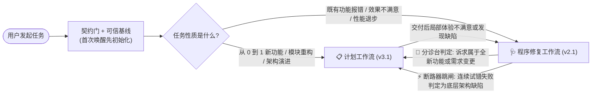
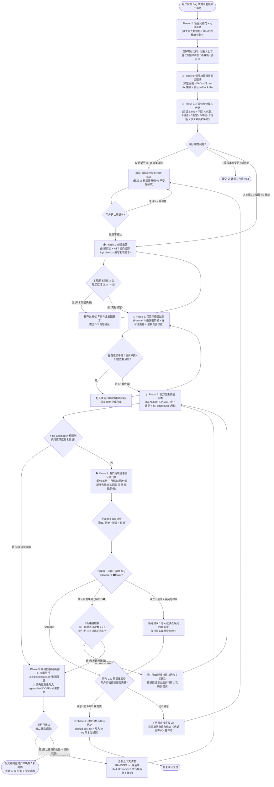

# 通用工业级程序修复与Bug清零工作流规范 (Bug-Fix & Self-Repair Constitution)

> **文档代码**：`PROGRAM_REPAIR_WORKFLOW.md` / `程序修复工作流.md`  
> **版本**：`v2.1-Project-Aware`（与 [`计划工作流.md`](./计划工作流.md) `v3.1`、[`UI审美与开源组件借鉴工作流.md`](./UI审美与开源组件借鉴工作流.md) `v1.1` 组成三位一体工作流体系；共用 [`项目适配与契约初始化工作流.md`](./项目适配与契约初始化工作流.md) 与 [`项目契约模板.md`](./项目契约模板.md)）  
> **适用范围**：跨语言、跨技术栈的故障诊断、缺陷修复（Bug-Fixing）、**AI 生成效果不满意纠偏**、性能劣化治理、视觉/交互微调以及多智能体协同排障场景。  
> **设计核心目标**：
>
> 1. **终结“v1 不满意 ➔ v2 不满意 ➔ v3 还不满意”的消耗战**：新增 **🏥 分诊台** 与 **《期望对齐卡》**，将“隐性主观不满”转化为“显性可验收契约”，未对齐期望严禁动刀。
> 2. **避免死循环与代码震荡**：统一 **2 次否决跳闸**、**`A ➔ B ➔ A` 震荡检测**、**假设黑名单** 与 **第二意见通道**，杜绝盲目猜改耗尽上下文。
> 3. **根治 AI“炫技手搓综合症”与供应链投毒**：引入 **Ponytail 六级懒惰阶梯**、**开源项目许可证兼容矩阵** 与 **幻觉包名（Slopsquatting）核验**。
> 4. **全生命周期无损回滚**：升级双分支防灾回滚脚本（同时锁定已提交 `HEAD` 与未提交 `WIP`），支持非 Git 项目目录快照退化。
> 5. **铁面看门狗与防作弊审计**：独立白纸视角五道门禁，严惩“删改测试、注入 `skip`/`exit(0)`、写死特判”等欺骗门禁行为（Reward Hacking）。
> 6. **项目语境优先**：修复前必须理解项目第一要义、质量排序和代码为何如此写；审查建议只是待验证假设，必须逐条裁决，禁止用局部最佳实践覆盖全局自洽设计。

> [!IMPORTANT]
> 任何 Agent 被 `@程序修复工作流.md` 唤醒时，必须先执行 [`@项目适配与契约初始化工作流.md`](./项目适配与契约初始化工作流.md)，确认 `.agents/PROJECT_CONTRACT.md` 为 `CONFIRMED`，并在用户认可的稳定版本上捕获可信基线。契约规定项目目标、必须保持的行为和设计意图；本文件规定通用修复流程。两者冲突时停止自动修改，向用户呈交证据与代价，由用户裁决或显式修订契约。

---

## 目录 (Table of Contents)

1. [最高执行宪法：修复十大铁律 (Constitutional Repair Charter)](#1-最高执行宪法修复十大铁律-constitutional-repair-charter)
2. [业界标杆吸收与理论基石 (Prior-Art Survey & Foundations)](#2-业界标杆吸收与理论基石-prior-art-survey--foundations)
3. [任务分级、共享约定与双工作流路由 (Task Tiers, Shared Conventions & Routing)](#3-任务分级共享约定与双工作流路由-task-tiers-shared-conventions--routing)
4. [修复子代理天团：日常命名角色与边界锁定 (Specialized Subagent Taskforce)](#4-修复子代理天团日常命名角色与边界锁定-specialized-subagent-taskforce)
5. [全流程端到端状态机与流水线 (End-to-End State Machine)](#5-全流程端到端状态机与流水线-end-to-end-state-machine)
6. [分诊台：五类“不满意”精准分流与期望对齐卡 (Phase 0.5: Triage & Expectation Card)](#6-分诊台五类不满意精准分流与期望对齐卡-phase-05-triage--expectation-card)
7. [侦探战场：AST 导航、根因逆向追踪与二分定位 (Phase 1: AST, Root-Cause & Bisect)](#7-侦探战场ast-导航根因逆向追踪与二分定位-phase-1-ast-root-cause--bisect)
8. [借用审查员：Ponytail 懒惰阶梯、开源合规与供应链安全 (Phase 2: Laziness Ladder & FOSS Guard)](#8-借用审查员ponytail-懒惰阶梯开源合规与供应链安全-phase-2-laziness-ladder--foss-guard)
9. [主刀医生：微创手术协议与改动预算 (Phase 3: Surgical Patching & Budget)](#9-主刀医生微创手术协议与改动预算-phase-3-surgical-patching--budget)
10. [看门狗：白纸输入包、五道门禁与防作弊审计 (Phase 4: Watchdog 5-Gate & Anti-Cheating)](#10-看门狗白纸输入包五道门禁与防作弊审计-phase-4-watchdog-5-gate--anti-cheating)
11. [破局断路器：震荡熔断、第二意见与架构升级 (Phase 5: Circuit-Breaker & Second Opinion)](#11-破局断路器震荡熔断第二意见与架构升级-phase-5-circuit-breaker--second-opinion)
12. [出院交付与病历防复发归档 (Phase 6: Discharge & Post-Mortem Archive)](#12-出院交付与病历防复发归档-phase-6-discharge--post-mortem-archive)
13. [工业级配套脚本与工具箱 (Industrial Tooling & Scripts)](#13-工业级配套脚本与工具箱-industrial-tooling--scripts)
14. [附录：程序修复分级打卡检查单 (Tiered Execution Checklists)](#14-附录程序修复分级打卡检查单-tiered-execution-checklists)
15. [项目契约、建议裁决与知识回流 (Project Contract & Review Adjudication)](#15-项目契约建议裁决与知识回流-project-contract--review-adjudication)

---

## 1. 最高执行宪法：修复十大铁律 (Constitutional Repair Charter)

```
┌─────────────────────────────────────────────────────────────────────────────────┐
│                    【程序修复十大执行铁律 (The Ten Fix Iron-Rules)】            │
├─────────────────────────────────────────────────────────────────────────────────┤
│ 1. 无快照不动刀：未打基线标签（或目录快照）、未验证回滚安全网前，严禁修改生产代码。│
│ 2. 无靶标不修码：未写出稳定红灯复现脚本，或未由用户签字确认《期望对齐卡》，不准动刀│
│ 3. 严禁炫技手搓：未爬完 Ponytail 六级懒惰阶梯，严禁从零手搓已有标准解法的轮子。    │
│ 4. 严禁违规借用：引入外部代码或依赖必须穿透宿主开源协议兼容性与幻觉包名安全核验。 │
│ 5. 严禁篡改测试：严禁通过删改既有测试、降低断言精度、注入 skip/exit(0) 骗取绿灯。 │
│ 6. 改恶立刻跳闸：连续 2 次看门狗否决、发生代码震荡或引发次生回归，立即断路回滚。  │
│ 7. 裁判选手分离：主刀医生无权宣布完工，必须由独立白纸上下文的看门狗跑通五道门禁。 │
│ 8. 无语境不动刀：契约未 CONFIRMED、反直觉设计未理解、可信基线未捕获，严禁修改代码│
│ 9. 严禁照单全收：审查建议须逐条裁决并记录证据；拒绝照改局部“最佳实践”破坏全局自洽│
│ 10. 无证据不宣布：未验证项明确列为 PARTIAL，禁止把跳过项写成全绿。               │
└─────────────────────────────────────────────────────────────────────────────────┘
```

---

## 2. 业界标杆吸收与理论基石 (Prior-Art Survey & Foundations)

本工作流深度吸收了自动程序修复（APR）、规范驱动开发与多智能体工程治理领域的 9 个代表性项目与安全实践：

| 标杆项目 / 工程体系 | 领域定位 | 汲取的核心策略与工程机制 | 规避的反面教训 |
| :--- | :--- | :--- | :--- |
| **Aider** (`Aider-AI/aider`, 49k+★) | AI 结对编程 | **Git-First 原子提交**（每次改动可秒级反悔）；**Tree-sitter Repo Map**（低 Token 感知代码骨架）；**SEARCH/REPLACE 微创补丁**。 | 规避整文件全量重写带来的大面积幻觉覆盖与次生污染。 |
| **SWE-agent** (`SWE-agent/SWE-agent`, 20k+★) | 自动 Issue 修复 | **Agent-Computer Interface (ACI)** 结构化代码定位；**Reproduce-First** 铁律；受控单步预算。 | 规避无复现验证直接盲改生产代码。 |
| **AutoCodeRover** (`AutoCodeRoverSG/auto-code-rover`, 3.1k+★) | AST 故障定位 | **AST 层次化病灶缩窄**（文件 ➔ 类 ➔ 函数 ➔ 语句）；结合测试覆盖谱（SBFL）推断根因。 | 规避用 `grep` 全库关键词盲搜导致的假阳性误判。 |
| **Agentless** (`OpenAutoCoder/Agentless`, 2.1k+★) | 确定性修复流水线 | **反死循环确定性阶段**（分级定位 ➔ 多候选补丁采样 ➔ 回归过滤重排）；用于断路器跳闸后的“第二意见”。 | 规避长对话自循环引发的认知衰退（Context Rot）。 |
| **OpenHands** (`All-Hands-AI/OpenHands`, 88k+★) | 智能体运行时 | **Stuck Detection（停滞与震荡检测）**；沙箱隔离执行；事件流全链路可审计回放。 | 规避智能体在同一报错上反复执行相同无效动作。 |
| **Ponytail** (`DietrichGebert/ponytail`) | 反过度设计插件 | **“最懒资深工程师”六级懒惰阶梯（Ladder of Laziness）**；强制优先复用库内/标准库/原生能力；`ponytail:` 技术债显式标记。 | 规避 AI 炫技手搓几百行脆弱包装类或私有算法。 |
| **Superpowers** (`obra/superpowers`) | 系统化调试与协作技能 | **根因逆向追踪**；单次单假设验证；多次修复失败即升级架构共商；`receiving-code-review` 明确要求验证审查意见是否适合当前代码库、是否破坏既有功能、原实现是否有合理原因。 | 规避“哪里报错就在哪里打补丁”和照单全收局部审查建议。 |
| **GitHub Spec Kit** (`github/spec-kit`) | Constitution / Clarify / Analyze | 项目原则与通用流程分离；澄清覆盖质量属性与可测完成信号；一致性分析把 Constitution 冲突视为关键问题。 | 形成项目契约层，避免用一套默认验收标准审判所有项目。 |
| **AGENTS.md** (`agentsmd/agents.md`) | 项目级 Agent 指令 | 可预测、跨 Agent 自动发现的项目上下文入口与目录级覆盖。 | 契约纳入 Git，作为跨会话长期事实来源。 |
| **Architecture Decision Record** (`joelparkerhenderson/architecture-decision-record`) | 决策知识管理 | 保存决策背景、理由、后果与 fitness function；把重要不变量转成可执行检查。 | 解释反直觉代码“为何存在”，防止误把设计当缺陷。 |
| **ScanCode / Licensee / OSV-Scanner** | 开源合规与供应链 | 许可证 SPDX 精确识别与兼容矩阵核查；结合官方仓库元数据与 OSV 漏洞库拦截**幻觉包名投毒（Slopsquatting）**。 | 规避开源项目混入传染性不兼容代码或拉取恶意抢注包。 |
| **METR / Reward-Hacking 防御实践** | 评测防作弊 | **既有测试只读保护**；Git Diff 篡改审计；拦截 `skip`/`xfail`/`exit(0)` 与针对测试输入的硬编码特判。 | 规避 AI 为追求表面绿灯而篡改裁判规则。 |

---

## 3. 任务分级、共享约定与双工作流路由 (Task Tiers, Shared Conventions & Routing)

> [!IMPORTANT]
> 本章为 [`程序修复工作流.md`](./程序修复工作流.md) 与 [`计划工作流.md`](./计划工作流.md) 的**共享契约层**。两份工作流共用相同的目录结构、术语定义、标签命名与配套脚本。

### 3.0 所有修复任务的前置总门 (Project Contract & Trusted Baseline)

1. 执行 [`@项目适配与契约初始化工作流.md`](./项目适配与契约初始化工作流.md)：新项目先完成契约确认，已确认项目按任务读取相关章节。所有任务至少读取第 1、2、5 章；触及核心链路、反直觉设计或证据命令时必须读取对应的第 3、4、6 章；涉及审查建议或知识回流时读取第 8 章；M/L 级读取全部相关章节。不得借 S 级流程跳过设计意图。
2. 在用户认可的稳定版本上运行 `./scripts/capture_baseline.sh <stable-ref>`，记录基线 SHA、已知失败签名、核心回归、冒烟、静态检查与性能数值。契约、命令、阈值和稳定版本不变时复用该基线，不要求每次修复重捕。
3. 契约未确认、含占位符、基线缺失或契约在基线后被修改时，`fix_attempt.sh` 以 `Exit 200` 阻断；证据命令、性能阈值或方向在基线后被修改时，`watchdog_gate.sh` 以 `Exit 106` 阻断。不得绕过门禁直接改代码。
4. 反直觉或核心链路代码修改前，必须回答：服务哪个契约目标、上下游依赖、为何如此写、哪些行为必须保持、如何验证；答案写入 `.agents/fix-log/ISSUE-<id>.md`。

### 3.1 双工作流协同路由规则 (Workflow Routing)



### 3.2 任务复杂度三级分流 (S / M / L Task Tiering)

为防止“改一行拼写错误也要跑全套重型流程导致 Agent 偷偷跳步”，所有修复任务在入口处按影响面分为 **S / M / L** 三级：

| 等级 | 判定标准（需同时满足） | 必选流程裁剪规则 | 改动预算上限 |
| :--- | :--- | :--- | :--- |
| **🟢 S 级（微创快修）** | • 仅涉及 **1 个文件** 且改动 **$\le 30$ 行**<br/>• 不修改公共 API 签名与数据结构<br/>• 不引入任何新外部依赖<br/>• 根因明确（如空指针防御、样式微调、配置修正） | 1. 保险箱打快照<br/>2. 侦探写复现（或分诊台签期望卡）<br/>3. 主刀医生打补丁（跳过外部标杆检索，仅查库内与标准库）<br/>4. 看门狗跑 `./scripts/watchdog_gate.sh` | $\le 30$ 行代码，最多 1 个文件 |
| **🟡 M 级（标准排障）** | • 涉及 **2–5 个文件** 或改动 **31–150 行**<br/>• 或需引入 1 个轻量成熟依赖<br/>• 或曾出现 1 次用户“效果不满意” | 完整执行 Phase 0 ➔ Phase 6 全流程；借用审查员执行 Ponytail 六级阶梯 + 至少对标 **1 个**外部成熟实现。 | $\le 150$ 行代码，严禁顺手重构无关文件 |
| **🔴 L 级（疑难会诊）** | • 涉及 **$>5$ 个文件**、跨模块并发/状态流转、公共契约变更<br/>• 或 S/M 级任务触发过 **断路器跳闸**<br/>• 或发生过 **$\ge 2$ 轮用户不满意返工** | 完整执行全流程 + 至少解构 **3 个**开源标杆 + 启用 **第二意见通道**（基于 `git worktree` 并行生成 2–3 个候选方案交由看门狗择优）。 | 按分阶段微存档（Micro-Checkpoint）逐步推进 |

> **用户显式豁免通道（Explicit Waiver）**：若用户明确指令“本次跳过某步骤”，Agent 可执行豁免，但必须在 `.agents/decisions/ADR-xxx.md` 与最终交付报告中如实记录 `[WAIVED BY USER]`，严禁 Agent 未经授权自行跳步。

### 3.3 统一术语与精确计量口径

1. **一次试错（One Fix Attempt）**：主刀医生完成一次代码修改、通过 `./scripts/fix_attempt.sh` 生成 `fix-attempt/<id>/<n>` 标签并提交给看门狗，经看门狗执行门禁后判定为 **否决（FAIL）**，计为 **1 次试错**（语法未编过前的本地保存不重复计次，但单次尝试内本地调试不得超过 3 轮命令执行）。
2. **同一病灶（Same Fault Target）**：绑定同一个复现脚本路径（如 `tests/repro_104.py`）或同一张《期望对齐卡》编号（如 `EXP-104`）的排障过程。
3. **代码震荡（Code Oscillation）**：第 $N$ 次尝试提交后的代码树与第 $N-1$ 次或第 $N-2$ 次完全相同（即 `git diff fix-attempt/<id>/<prev> fix-attempt/<id>/<N>` 为空，出现 `A ➔ B ➔ A` 循环）。

### 3.4 共享状态目录 `.agents/` 与跨会话交接协议

为彻底解决“长对话上下文腐化（Context Rot）”与“重置会话后新 Agent 失忆重蹈覆辙”，项目根目录下统一维护 `.agents/` 目录（加入 `.gitignore` 或回滚白名单保护）：

```text
.agents/
├── PROJECT_CONTRACT.md      # 已确认并纳入 Git 的项目第一要义、质量排序、设计意图与证据契约
├── decisions/               # 纳入 Git 的 ADR 与显式豁免记录
├── fitness/                 # 纳入 Git 的长期不变量检查资产
├── baseline/                # 本地可信基线、失败签名与性能数值（不入库）
├── workflow.config          # Phase -1 自动生成的环境配置 (TEST_CMD / CORE_REGRESSION_CMD / SMOKE_CMD / LINT_CMD / BENCH_CMD / PROJECT_LICENSE 等)
├── HANDOFF.md               # 跨会话/跨子代理交接单：当前阶段、已否决假设黑名单、下一步唯一指令
├── expectations/
│   └── EXP-104.md           # 分诊台生成的《期望对齐卡》（针对“效果不满意”场景）
├── fix-log/
│   └── ISSUE-104.md         # 侦探与主刀医生维护的《假设日志与修复病历》
├── decisions/
│   └── ADR-001.md           # 人机共商对齐决议或用户豁免记录
└── snapshots/               # 非 Git 项目的目录级快照退化存储区
```

#### `.agents/workflow.config` 标准键值范例

```bash
# 由 Phase -1 环境感知自动探测生成
PROJECT_LANG="python"
PROJECT_LICENSE="MIT"              # 自动读取根目录 LICENSE 文件 SPDX 标识；未声明则记为 "UNLICENSED"
BASE_BRANCH="main"
TEST_DIR="tests"
TEST_CMD="pytest -q"
CORE_REGRESSION_CMD="pytest -q tests/test_core_path.py"
SMOKE_CMD="pytest -q tests/test_smoke_main_flow.py"
LINT_CMD="ruff check ."
BENCH_CMD=""                       # 若无基准脚本则留空，看门狗会列入尚未验证；PERF_CRITICAL=1 时禁止留空
BENCH_THRESHOLD="3"
BENCH_HIGHER_IS_BETTER="0"         # 时延等低值更优用 0；吞吐等高值更优用 1
PERF_CRITICAL="0"
CONTRACT_PATH=".agents/PROJECT_CONTRACT.md"
```

### 3.5 非 Git 项目的环境初始化与退化安全网

当工作区尚处于未初始化 Git 的裸目录状态时（`git rev-parse --is-inside-work-tree` 失败）：
1. **首选方案**：保险箱管理员主动询问用户：“检测到当前目录尚未初始化 Git 仓库，是否允许执行 `git init` 并创建初始安全基线提交？”
2. **退化方案**：若用户希望保持纯目录结构，自动切换为 `.agents/snapshots/<timestamp>` 目录快照模式，`./scripts/rollback.sh` 自动通过 `rsync` 实现秒级备份与恢复。

---

## 4. 修复子代理天团：日常命名角色与边界锁定 (Specialized Subagent Taskforce)

修复流水线由 **7 个日常命名、职责互斥、读写权限严格隔离**的子代理角色组成，让你一眼看名字就知道它在干什么：

```
                     ┌────────────────────────────────────┐
                     │   用户诉求：报错 / 不满意 / 性能慢  │
                     └─────────────────┬──────────────────┘
                                       │
                      ┌────────────────▼────────────────┐
                      │  🦺 保险箱管理员 (Safe Keeper)   │ ➔ 锁死当前 HEAD + 打 pre-fix 快照
                      └────────────────┬────────────────┘
                                       │
                      ┌────────────────▼────────────────┐
                      │  🏥 分诊台 (Triage Nurse) [新增] │ ➔ 区分五类问题 + 签《期望对齐卡》
                      └───────┬────────────────┬────────┘
                 [客观报错/性能]                [期望不符/审美体验]
                      │                                │
                      ▼                                ▼
       ┌─────────────────────────────┐  ┌─────────────────────────────┐
       │   🕵️ 侦探 (The Detective)   │  │ 用户确认《期望对齐卡》后转交 │
       │ AST 逆向追踪 + 红灯复现脚本 │  │ 侦探固化为断言或视觉快照测试 │
       └──────────────┬──────────────┘  └──────────────┬──────────────┘
                      └────────────────┬───────────────┘
                                       │
                      ┌────────────────▼────────────────┐
                      │ 🧐 借用审查员 (Borrowing Auditor)│ ➔ 爬 Ponytail 懒惰阶梯 + 开源/包安全核查
                      └────────────────┬────────────────┘
                                       │
                      ┌────────────────▼────────────────┐
                      │   🩺 主刀医生 (Lead Surgeon)     │ ➔ SEARCH/REPLACE 微创手术 + 记录尝试
                      └────────────────┬────────────────┘
                                       │
                      ┌────────────────▼────────────────┐
                      │   🐕 看门狗 (The Watchdog)       │ ➔ 独立白纸上下文执行五道门禁 + 防作弊审计
                      └───────┬────────────────┬────────┘
                              │                │
               [门禁否决 / 触发断路阈值]        [已验证项通过 + 用户满意]
                              │                │
                              ▼                ▼
             ┌──────────────────────────┐  ┌──────────────────────────┐
             │ ⚡ 破局断路器 (Breaker)   │  │ 🦺 封版归档 + 写入病历库 │
             │ (回滚 + 第二意见 / 共商) │  └──────────────────────────┘
             └──────────────────────────┘
```

### 4.1 七大子代理权限与输入输出契约表

| 角色代号 | 一句话定位 | 标准输入 (Input) | 强制交付物 (Output) | 绝对禁止红线 (Forbidden) |
| :--- | :--- | :--- | :--- | :--- |
| **🦺 保险箱管理员**<br/>*(Safe Keeper)* | 管存档、管备份、管无损回滚 | 当前工作区状态、目标标签名 | `pre-fix-*` 标签、`rescue/head_*` 与 `rescue/wip_*` 分支、`post-fix-*` 标签 | **严禁阅读或修改业务逻辑代码**；严禁删除白名单保护资产。 |
| **🏥 分诊台**<br/>*(Triage Nurse)* | 把模糊的“不满意”翻译成明确靶标 | 用户原始反馈、项目契约、可信基线、历史版本对比 | 任务等级（S/M/L）、五分类标签、经用户确认的《期望对齐卡》（`EXP-xxx.md`）、受影响契约条款 | **未经用户确认期望卡，严禁放行主刀医生动刀**；严禁自行脑补用户审美偏好或质量排序。 |
| **🕵️ 侦探**<br/>*(The Detective)* | 查病灶、追调用链、写红灯复现脚本 | 报错日志/期望卡、契约第 3/4 章、源码库、稳定基线 | 《病灶调查卷宗》、稳定复现脚本（`tests/repro_xxx.py`）、初始假设日志、原实现存在原因分析 | **严禁修改任何生产业务代码**；只准在 `tests/` 或 `.agents/` 下写入文件；严禁把未理解的兼容路径直接定为缺陷。 |
| **🧐 借用审查员**<br/>*(Borrowing Auditor)* | 专治炫技手搓、查开源协议与假包 | 侦探卷宗、主刀医生的拟定方案 | 《反手搓与开源借用合规签批单》（含 Ponytail 阶梯核查与 SPDX 协议结论） | **严禁放行未爬完懒惰阶梯的自研轮子**；严禁放行协议冲突代码或幻觉包名。 |
| **🩺 主刀医生**<br/>*(Lead Surgeon)* | 按靶标做最小面积微创手术 | 侦探卷宗、审查签批单、契约相关章节、建议裁决表、源码文件 | 微创补丁、`fix-attempt/<id>/<n>` 标签、更新后的假设日志与被拒绝建议理由 | **严禁修改既有测试文件**；严禁整文件重写；严禁一次采纳多个未经证明相关的建议；严禁自行宣布修复完成。 |
| **🐕 看门狗**<br/>*(The Watchdog)* | 独立项目语境白纸视角的挑刺质检官 | **七件套白纸输入包**（靶标、净变更、项目契约、ADR/基线、环境配置、稳定标签、门禁脚本） | `watchdog_gate.sh` 证据门禁报告、逐条待裁决建议、缺陷分级（🔴/🟠/🟡） | **严禁读取主刀医生的推理辩解过程**；严禁把建议写成必须执行的命令；严禁动手帮主刀医生改代码。 |
| **⚡ 破局断路器**<br/>*(Circuit Breaker)* | 监控死循环与震荡，强制拉闸止损 | `fix-log` 计数、Git 历史 Diff、看门狗判决 | 跳闸指令、`HANDOFF.md`（含假设黑名单）、第二意见调度或人机共商对齐单 | 达到跳闸红线时**严禁通融主刀医生“再试最后一次”**。 |

---

## 5. 全流程端到端状态机与流水线 (End-to-End State Machine)



---

## 6. 分诊台：五类“不满意”精准分流与期望对齐卡 (Phase 0.5: Triage & Expectation Card)

### 6.1 为什么会出现“改了三版还是不满意”？

在实际开发中，你对 AI 产出的结果不满意，往往**不全是因为代码报错（Crash）**，而是因为**你心中的期望与 AI 脑补的实现存在错位**。如果此时直接让 AI 写代码或硬套报错复现脚本，AI 只会在错误的方向上反复微调，导致“第 1 版不满意、第 2 版换个丑法、第 3 版把原来好的功能也改坏了”。

因此，**🏥 分诊台（Triage Nurse）** 必须在动刀前将所有问题精确归入以下 5+1 类，并匹配对应的靶标工具：

| 分类代码 | 问题性质 | 用户的典型反馈 | 强制前置靶标（无此物不准动刀） | 终审裁判 |
| :--- | :--- | :--- | :--- | :--- |
| **A 类：崩溃/异常** | 程序抛错、闪退、死锁、接口 500 | “点这个按钮直接报错退出” | 侦探编写的**确定性红灯复现脚本**（`Exit Code != 0`） | 🐕 看门狗 |
| **B 类：逻辑偏差** | 无报错，但计算结果、状态流转错误 | “筛选条件选了 A，出来的结果混了 B” | 侦探编写的**输入➔期望输出断言脚本**（`AssertionError`） | 🐕 看门狗 |
| **C 类：期望不符** | 功能能跑，但交互方式/业务行为不是想要的效果 | “能用，但不是我想要的那种交互逻辑” | 分诊台生成 **《期望对齐卡》** ➔ **用户确认** ➔ 转化为新行为断言 | 🐕 看门狗 + 👤 用户 |
| **D 类：审美/体验** | 布局拥挤、动画生硬、配色别扭、半行切边 | “界面看着很乱，没有呼吸感，不如上一版顺眼” | 分诊台生成 **《期望对齐卡》**；仅在契约第 7 章启用 UI 规则时，唤醒 [`@UI审美与开源组件借鉴工作流.md`](./UI审美与开源组件借鉴工作流.md) 按需选择候选 UI/动效原语 | 🐕 看门狗 + 👤 用户 |
| **E 类：性能劣化** | 响应变慢、内存暴涨、CPU 飙高、卡顿 | “改完之后比上一版明显卡顿” | 侦探编写**性能基准脚本** + **`git bisect` 定位劣化提交** | 🐕 看门狗 |
| **F 类：需求变更** | 本质是增加新模块或推翻原有产品定义 | “我打算把单机版改成多租户协同架构” | **终止修复工作流**，无缝路由至 [`计划工作流.md`](./计划工作流.md) | 计划工作流 |

### 6.2 《期望对齐卡》(Expectation Alignment Card) 标准模板

当分诊台判定问题属于 **C 类（期望不符）** 或 **D 类（审美/体验）** 时，必须立即在 `.agents/expectations/EXP-<id>.md` 生成如下卡片，并向用户展示：

```markdown
# 🏥 期望对齐卡 (EXP-104)
- **分诊类型**：[C 期望不符 / D 审美体验] | **任务分级**：[S / M / L]
- **基线快照**：`pre-fix-104-20261024`
- **可信基线**：`.agents/baseline/manifest.env` 中的 SHA、已知失败签名与性能数值
- **受影响契约条款**：`[P1 / C-xx / D-xx / 证据命令编号]`
- **交互音效选项**：仅当契约第 7 章启用 UI 规则且契约未回答时询问；`audio_sensitive=true` 时直接禁音
- **UI 借鉴源（若属 D 类且契约启用）**：调用 `@UI审美与开源组件借鉴工作流.md`，组件库作为候选而非强制清单

## 1. 现状客观描述 (Current Behavior)
- 当前代码表现为：弹窗宽度随内容无限撑开，长文本未折行，且关闭按钮位于左下角。

## 2. 目标期望契约 (Target Expectation - 具象且可度量)
- **正例 1（应该怎样）**：弹窗最大宽度锁定为 `min(640px, 90vw)`，超长文本自动折行，左右内边距固定 `24px`。
- **正例 2（应该怎样）**：关闭按钮固定在右上角（距顶 `16px`、距右 `16px`），支持按 `Esc` 键关闭。
- **反例（绝对不要怎样）**：严禁出现横向滚动条；严禁改变弹窗内部表单的提交逻辑。

## 3. 保护白名单 (Do-Not-Touch List)
- 保持 `src/components/ModalForm.tsx` 的数据校验与 API 请求逻辑 100% 不变。
- 复制契约第 3 章的“必须保持的行为”与第 4 章的“禁止简化方式”；不得因通用最佳实践删除反直觉但已确认的设计。

## 4. 机器可验证断言 (Verifiable Assertions)
- DOM/样式断言：`getComputedStyle(modal).overflowX === 'hidden'` 且 `modal.getBoundingClientRect().width <= 640`。
```

> [!CAUTION]
> **防循环铁律（No Re-Patch Without Re-Align）**：  
> 对于 C/D 类问题，若第 1 版修改通过了看门狗检查，但用户预览后仍表示“不满意”，**主刀医生绝对禁止直接猜着改第 2 版**！必须退回分诊台，对比“上一版期望卡漏掉了哪条隐性预期”，更新《期望对齐卡》并经用户二次确认后，才允许做第 2 次微创手术。

---

## 7. 侦探战场：AST 导航、根因逆向追踪与二分定位 (Phase 1: AST, Root-Cause & Bisect)

### 7.1 AST 抽象语法树与依赖图谱定位法 (Anti-Grep)

盲目使用 `grep` 搜索关键词会把同名变量、注释、无关模块全部卷入上下文，引发严重误判。🕵️ 侦探代理必须执行三级拓扑缩窄（借鉴 AutoCodeRover 与 Aider Repo Map）：

1. **第一级：仓库骨架映射（Tree-sitter Repo Map）**：先读取模块签名骨架（类、公开函数签名与导入导出关系），锁定候选文件集合（通常 $\le 3$ 个文件）。
2. **第二级：AST 节点精确定位**：解析目标文件的 `FunctionDeclaration` / `ClassDeclaration` / `MethodDefinition`，提取目标函数的入参类型、返回值契约、异常捕获块与状态读写边界。
3. **第三级：调用链出入度影响评估（Call Graph Impact）**：
   - **入度（Who calls me）**：统计有哪些上游模块调用了该函数。若入度 $> 5$，标记为 **`[高危公共基础设施]`**，严禁直接破坏原有函数签名（必须通过可选参数或适配器保持向上兼容）。
   - **出度（Whom I call）**：核查其调用的底层库或外部接口返回值边界。

### 7.2 根因逆向追踪四步法 (Superpowers Backward Root-Cause Tracing)

报错堆栈的第一现场往往只是**受害者（Symptom）**，而非**始作俑者（Root Cause）**。侦探必须沿调用链逆向溯源（借鉴 `obra/superpowers` 的 `systematic-debugging`）：

```
┌─────────────────────────────────────────────────────────────────────────────────┐
│              【根因逆向追踪四步法 (Backward Root-Cause Tracing)】               │
├─────────────────────────────────────────────────────────────────────────────────┤
│ Step 1. 观察爆炸点 (Symptom)  ：记录崩溃或断言失败的具体行号与当时的非法变量值。│
│ Step 2. 锁定直接诱因 (Trigger)：哪一行代码直接把非法值传了进来或触发了分支？    │
│ Step 3. 逆向逐跳追问 (Walk Up)：沿着 Call Stack 向上一层层追问：“是谁调用了我？ │
│                                 在这一跳里，数据还是合法的吗？”                 │
│ Step 4. 揪出源头病灶 (Origin) ：找到好数据第一次变成坏数据、或状态契约第一次被  │
│                                 违反的那一层——手术刀必须落在源头，而非爆炸点！  │
└─────────────────────────────────────────────────────────────────────────────────┘
```

> **典型反例警示**：深层工具函数收到 `path = ""` 报错，错误修法是在工具函数里加 `if not path: return None`（掩盖症状，导致下游静默数据丢失）；正确修法是逆向追踪发现上游配置解析器在特定环境变量下漏传了默认值，在源头修复配置解析契约。

### 7.3 “上一版是好的，这一版坏了”利器：`git bisect run` 自动二分定位

当你遇到“之前某个版本还好好的，不知道哪次改动搞坏了”时，严禁人工翻阅几十个 Commit 瞎猜。侦探必须使用 Git 原生二分查找：

```bash
# 1. 编写好独立复现脚本 tests/repro_104.py (好版本返回 0，坏版本返回 1)
# 2. 启动自动二分定位 (指定当前坏状态 HEAD 与已知好版本 Tag)
git bisect start HEAD pre-feature-stable
git bisect run python3 tests/repro_104.py

# 3. Git 将在数秒内自动检出并锁定引入 Bug 的精确罪魁祸首 Commit (First Bad Commit)
# 4. 记录罪魁 Commit 的 git show 差异后，退出二分模式
git bisect reset
```

### 7.4 红灯复现脚本刚性契约与防偶发（Flaky）规则

```
┌─────────────────────────────────────────────────────────────────────────────────┐
│                【红灯复现脚本五大刚性契约 (The Red-Test Contract)】             │
├─────────────────────────────────────────────────────────────────────────────────┤
│ 1. 独立自包含：单文件可独立运行（如 tests/test_repro_104.py），不依赖外部手工操作│
│ 2. 标准断言化：使用标准测试断言（assert / unittest / pytest / Playwright），    │
│    未修复前自然抛出 AssertionError（Exit Code != 0），修复后自然返回 0。        │
│ 3. 防偶发校验（3/3 规则）：                                                     │
│    • 动刀前连跑 3 次，必须 3/3 全部稳定红灯（拒绝偶发假复现）；                 │
│    • 若涉及并发/时序，修复后看门狗连跑 3 次，必须 3/3 全部稳定绿灯。            │
│ 4. 极速执行：单次运行耗时控制在 3 秒以内（UI/E2E 快照控制在 10 秒以内）。       │
│ 5. 终身回归资产：命名遵循 test_repro_<id> 规范，修复后自动纳入全量回归测试套件。│
└─────────────────────────────────────────────────────────────────────────────────┘
```

#### 标准复现测试模板（可直接被 `pytest` / `unittest` 与 `watchdog_gate.sh` 双重识别）

```python
# tests/test_repro_104_cache_eviction.py
"""
【复现测试】ISSUE-104: 高频写入下 LRU 缓存未按容量上限淘汰旧节点
- 根因定位: src/core/cache.py :: LRUCache.put() 在键已存在时未更新访问顺序且满容分支漏判
- 修复前预期: 抛出 AssertionError，退出码 != 0 (红灯)
- 修复后预期: 断言全部通过，退出码 == 0 (绿灯)，并终身保留在 tests/ 回归套件中
"""
import unittest
from src.core.cache import LRUCache


class TestReproIssue104(unittest.TestCase):
    def test_lru_evicts_oldest_when_over_capacity(self):
        cache = LRUCache(capacity=10)
        for i in range(100):
            cache.put(f"key_{i}", f"val_{i}")

        self.assertEqual(
            len(cache),
            10,
            f"BUG-104 复现: 缓存未淘汰，当前长度 {len(cache)} 超过容量上限 10",
        )
        self.assertIsNone(cache.get("key_0"), "最早写入的 key_0 应当已被驱逐")
        self.assertEqual(cache.get("key_99"), "val_99", "最新写入的 key_99 应当保留")


if __name__ == "__main__":
    unittest.main()
```

#### 视觉/UI 类问题的确定性复现模板（Playwright Golden Snapshot）

对于 D 类（视觉排版、样式错位、半行切边）问题，侦探可使用几何边界断言或 Playwright 视觉快照：

```typescript
// tests/test_repro_105_modal_layout.spec.ts
import { test, expect } from '@playwright/test';

test('ISSUE-105: 弹窗在长文本下不得出现横向滚动条且保持留白', async ({ page }) => {
  await page.goto('/demo-modal');
  const modal = page.locator('[data-testid="settings-modal"]');
  await expect(modal).toBeVisible();

  // 1. 几何与样式确定性断言
  const box = await modal.boundingBox();
  expect(box!.width).toBeLessThanOrEqual(640);
  const overflowX = await modal.evaluate((el) => getComputedStyle(el).overflowX);
  expect(overflowX).toBe('hidden');

  // 2. 金标准像素快照比对 (容忍跨平台抗锯齿 <= 1%)
  await expect(modal).toHaveScreenshot('settings-modal-golden.png', {
    maxDiffPixelRatio: 0.01,
  });
});
```

---

## 8. 借用审查员：Ponytail 懒惰阶梯、开源合规与供应链安全 (Phase 2: Laziness Ladder & FOSS Guard)

### 8.1 根治 AI“炫技手搓综合症”：Ponytail 六级懒惰阶梯 (`DietrichGebert/ponytail`)

AI 编码智能体最大的恶习之一，是遇到简单问题时喜欢炫技手搓几百行复杂的私有工具类、自定义状态机或非标算法。**🧐 借用审查员（Borrowing Auditor）** 引入开源项目 **Ponytail** 的核心哲学——**“房间里最懒的资深工程师：最好的代码是你根本不需要写的代码”**。

主刀医生在动手写任何新辅助函数或引入新逻辑前，必须自上而下逐级攀爬 **Ponytail 六级懒惰阶梯**：

```
┌─────────────────────────────────────────────────────────────────────────────────┐
│              【Ponytail 六级懒惰阶梯 (The 6-Step Ladder of Laziness)】          │
├────────┬────────────────────────────┬───────────────────────────────────────────┤
│ 阶梯   │ 审查员强制追问             │ 裁决动作                                  │
├────────┼────────────────────────────┼───────────────────────────────────────────┤
│ 第 1 级│ 这段逻辑真的需要存在吗？   │ 若可通过简化配置或删减冗余分支解决，直接删│
│ 第 2 级│ 当前项目仓库里已经有了吗？ │ 搜索项目内既有 utils/helpers，有则直接复用│
│ 第 3 级│ 语言标准库原生支持吗？     │ 如 Python functools/heapq/bisect/pathlib、│
│        │                            │ Go sync/slices，标准库有则严禁手写或引包！│
│ 第 4 级│ 运行时/浏览器原生支持吗？  │ 如原生 `<dialog>`、`structuredClone()`、  │
│        │                            │ `Intl`、`URLSearchParams`，优先用原生 API │
│ 第 5 级│ 已安装的依赖包里自带了吗？ │ 检查 lockfile 中已装库是否已含该能力      │
│ 第 6 级│ 能用成熟轻量的单行写法吗？ │ 仅当前 5 级均否定，才允许借用合规外部库或 │
│        │                            │ 编写极简代码（若有妥协需加 ponytail: 标记）│
└────────┴────────────────────────────┴───────────────────────────────────────────┘
```

#### 有意保留的极简技术债标记（`ponytail:` Tag）
若为避免过度设计而采用简单直接的权宜实现，必须在代码注释中标注：
`# ponytail: 当前并发量 < 100，使用标准库内存字典即可，待 QPS > 5000 再切换 Redis`

### 8.2 开源项目许可证双向兼容矩阵 (FOSS License Compatibility Guard)

由于你的项目通常作为**开源项目**发布，借用外部开源代码或引入依赖时，不仅要防闭源侵权，更要防止**许可证传染导致你的开源项目被迫更改协议**（例如你的项目是 MIT，若直接复制了 GPL 代码，整个仓库将被迫传染为 GPL）。

#### 第一步：区分“参考架构/算法思路”与“复制/改写源码”

| 借用深度 | 法律与版权定性 | 合规要求 |
| :--- | :--- | :--- |
| **A. 仅参考架构思想与通用算法逻辑**<br/>*(阅读标杆项目后，用本项目代码完全独立实现)* | 著作权法遵循“思想与表达二分法”，纯算法思路与架构模式不受版权传染限制（专利除外）。 | ✅ 允许跨协议参考；在文档或注释中礼貌致敬设计灵感来源（`Inspired by ...`）。 |
| **B. 通过包管理器引入第三方库**<br/>*(写入 `pyproject.toml` / `package.json` 动态调用)* | 属于库依赖调用，不修改对方源码。 | 🟢 MIT / Apache-2.0 / BSD / ISC / MPL-2.0 / LGPL（动态链接）均安全；🔴 GPL / AGPL 依赖会使宽松开源项目组合分发受限，需按矩阵裁决。 |
| **C. 直接复制或翻译源码片段**<br/>*(Copy-Paste 函数/文件或逐行改写)* | 构成衍生作品（Derivative Work），**100% 受原仓库开源许可证直接约束**。 | 必须严格执行下方《开源项目许可证兼容矩阵》，并完整保留原作者 Copyright 与 License 头！ |

#### 第二步：按宿主项目自身协议裁决（`.agents/workflow.config` 中的 `PROJECT_LICENSE`）

| 外部目标代码协议 | 若你的项目是 **MIT / BSD / ISC** | 若你的项目是 **Apache-2.0** | 若你的项目是 **GPL-3.0** | 借用约束与强制动作 |
| :--- | :--- | :--- | :--- | :--- |
| **MIT / BSD-2/3 / ISC / 0BSD** | 🟢 **批准借用** | 🟢 **批准借用** | 🟢 **批准借用** | 借用代码文件头部必须保留原作者 `Copyright` 与许可声明。 |
| **Apache-2.0** | 🟡 **允许（需声明）** | 🟢 **批准借用** | 🟢 **批准借用** | 需保留原 `NOTICE` 声明及文件修改记录；注意 Apache-2.0 与纯 GPL-2.0 不兼容（与 GPL-3.0 兼容）。 |
| **MPL-2.0 / LGPL-2.1/3.0** | 🟡 **仅限包依赖或独立文件隔离** | 🟡 **仅限包依赖或独立文件隔离** | 🟢 **批准借用** | 严禁将 MPL/LGPL 代码直接粘入 MIT/Apache 核心源文件内部；必须保持为外部包调用。 |
| **GPL-2.0 / GPL-3.0** | 🔴 **一票否决（协议传染）** | 🔴 **一票否决（协议传染）** | 🟢 **同协议可用** | 若你的项目是宽松协议（MIT/Apache），严禁复制任何 GPL 代码，否则项目将被迫传染为 GPL。 |
| **AGPL-3.0 / SSPL** | 🔴 **绝对禁止** | 🔴 **绝对禁止** | 🔴 **禁止（网络传染）** | 只要通过网络提供服务即触发全量源码公开义务，一律拦截。 |
| **无 LICENSE 文件（No License）** | 🔴 **绝对禁止（默认保留所有权利）** | 🔴 **绝对禁止** | 🔴 **绝对禁止** | GitHub 上未挂 LICENSE 的仓库默认等于**全版权专有代码**，严禁复制哪怕一个函数！ |

#### 合规借用代码头注释标准模板（以真实开源库为例）

```python
# -------------------------------------------------------------------------
# [BORROWED UNDER PERMISSIVE LICENSE - AUDITED BY @借用审查员]
# Upstream Repo : https://github.com/tkem/cachetools
# Original File : src/cachetools/lru.py
# SPDX License  : MIT License (Compatible with Host Project License: MIT)
# Copyright     : Copyright (c) 2014-2025 Thomas Kemmer
# Modification  : Extracted core OrderDict move_to_end eviction boundary check
# -------------------------------------------------------------------------
```

### 8.3 防范 AI“幻觉包名投毒”（Anti-Slopsquatting & SCA 安全核验）

研究表明，大模型在推荐第三方库时有 15%–20% 的概率会拼凑出听起来极其合理、实则不存在的“幻觉包名”，攻击者会提前在 PyPI / npm 抢注这些幻觉包名并植入窃密脚本（即 **Slopsquatting 供应链投毒**）。

当确需新增任何外部依赖包时，借用审查员必须执行 **“三查准入制”**：
1. **查真伪与资历（Registry Verification）**：严禁盲目执行 `pip install` / `npm install`。必须先核实该包在官方仓库真实存在、创建时间 $> 6$ 个月、维护活跃且与知名开源仓库对应。
2. **查已知漏洞（CVE / OSV Audit）**：安装后立即运行 `pip-audit` / `npm audit` / `cargo audit` 或 `osv-scanner`，存在高危（High/Critical）未修复漏洞者立即回退。
3. **锁死哈希（Lockfile Pinning）**：必须更新项目锁定文件（`uv.lock` / `poetry.lock` / `package-lock.json` / `pnpm-lock.yaml`），严禁悬浮版本号。

---

## 9. 主刀医生：微创手术协议与改动预算 (Phase 3: Surgical Patching & Budget)

### 9.1 微创手术四大铁律

1. **禁止整文件重写**：严格采用 `SEARCH/REPLACE` 精确上下文锚点替换，严禁把几百行文件全量重打一遍。
2. **禁止顺手牵羊（Scope Creep）**：只准修改《病灶调查卷宗》或《期望对齐卡》点名的代码块。严禁顺手格式化无关代码、重命名无关变量或调整导入顺序。
3. **严守分级改动预算**：S 级改动 $\le 30$ 行；若主刀医生发现修复一个局部 Bug 需要改动超过预算上限，必须暂停并向分诊台申请升级任务等级或评估是否为架构缺陷。
4. **每次尝试强制记账**：每次修改完毕，必须调用 `./scripts/fix_attempt.sh <issue-id> "<本次根因假设>"`，自动生成 `fix-attempt/<id>/<n>` 标签并更新 `.agents/fix-log/ISSUE-<id>.md`。

### 9.2 微创补丁标准示例

```markdown
<<<<<<< SEARCH
def compute_backoff_delay(retry_count: int, base_delay: float = 0.5) -> float:
    # 缺陷：无上限指数退避，且无随机抖动（Jitter），高并发重试下引发惊群效应与数小时挂起
    return base_delay * (2 ** retry_count)
=======
def compute_backoff_delay(
    retry_count: int, base_delay: float = 0.5, max_delay: float = 30.0
) -> float:
    # 借用审查员批准：使用 Python 标准库 random 实现 Full Jitter 截断指数退避 (AWS 标准算法)
    import random
    capped_delay = min(max_delay, base_delay * (2 ** retry_count))
    return random.uniform(0.0, capped_delay)
>>>>>>> REPLACE
```

---

## 10. 看门狗：白纸输入包、五道门禁与防作弊审计 (Phase 4: Watchdog 5-Gate & Anti-Cheating)

### 10.1 什么是真正的“白纸视角”（Clean-Room Input Pack）？

如果让看门狗读取主刀医生的长篇排障对话，看门狗很容易被主刀医生的“自我辩解”带偏（Confirmation Bias）；但完全不给项目契约，又会把有意的实时优化、降级路径或兼容逻辑误判为缺陷。因此，唤醒 **🐕 看门狗** 时，只准向其投喂以下 **七件套项目语境白纸输入包**：

1. **靶标契约**：侦探的复现脚本（`tests/test_repro_xxx.py`）或用户确认的《期望对齐卡》（`.agents/expectations/EXP-xxx.md`）；
2. **代码净变更**：`git diff <pre-fix-tag> HEAD`（只看改了什么代码，不看主刀医生的心路历程）；
3. **项目契约**：第一要义、P1–P3、核心链路、反直觉设计原因、证据命令；
4. **长期决策与可信基线**：相关 `.agents/decisions/ADR-xxx.md`、`.agents/baseline/manifest.env`、已知失败签名；
5. **项目环境配置**：`.agents/workflow.config`；
6. **稳定基线标签**：用户认可的旧版本引用；
7. **门禁执行器**：`./scripts/watchdog_gate.sh`。

审查建议一律按“待验证假设”输出，附证据、受影响契约条款与验证方法；主刀医生必须逐条裁决为采纳、拒绝或暂缓，禁止照单全改。

### 10.2 看门狗出厂终审“五道门禁”

```
┌─────────────────────────────────────────────────────────────────────────────────┐
│             【门禁 0 + 看门狗出厂质检五道证据门禁 (Evidence Gates)】            │
├──────────┬──────────┬───────────────────────────────────────────────────────────┤
│ 门禁序号 │ 退出码   │ 刚性审计内容与通过标准                                    │
├──────────┼──────────┼───────────────────────────────────────────────────────────┤
│ 门禁 0   │ Exit 106│ 【契约与基线】CONFIRMED 契约、无占位符；契约/命令/阈值哈希一致│
│          │ Exit 107│ 基线测试仅允许已确认失败；已配置的核心/冒烟/静态必须通过    │
├──────────┼──────────┼───────────────────────────────────────────────────────────┤
│ 门禁 1   │ Exit 101 │ 【目标逆转】复现脚本从 Exit != 0 变为绝对 Exit == 0       │
│          │          │ （涉及并发/偶发场景需连跑 3 次，达成 3/3 全绿）。         │
├──────────┼──────────┼───────────────────────────────────────────────────────────┤
│ 门禁 2   │ Exit 104 │ 【防作弊审计 (Anti-Reward-Hacking)】                      │
│          │          │ • 核查 git diff：严禁未经授权修改或删除既有测试文件；     │
│          │          │ • 扫描新增代码：严禁注入 skip / xfail / only / exit(0)；  │
│          │          │ • 核查契约、基线证据、workflow.config 未被静默篡改；      │
│          │          │ • 人工抽检补丁：严禁针对测试入参写 `if x == test_val` 特判│
├──────────┼──────────┼───────────────────────────────────────────────────────────┤
│ 门禁 3   │ Exit 102 │ 【历史零新增失败】与基线失败签名对比，0 新增失败。       │
├──────────┼──────────┼───────────────────────────────────────────────────────────┤
│ 门禁 4   │ Exit 108 │ 【核心不退化】CORE_REGRESSION_CMD 与 SMOKE_CMD 必须通过   │
│          │ Exit 103 │ 【性能防改恶】BENCH_CMD 最后一行数值与基线按契约阈值比较 │
│          │          │ PERF_CRITICAL=1 时禁止缺失；其他缺失项列入尚未验证       │
├──────────┼──────────┼───────────────────────────────────────────────────────────┤
│ 门禁 5   │ Exit 105 │ 【静态与类型安全】通过 Linter / 编译器类型检查，0 语法错。│
└──────────┴──────────┴───────────────────────────────────────────────────────────┘
```

缺失证据不得输出“全绿”；用户明确记录 ADR 并设置 `ALLOW_UNVERIFIED=1` 时，脚本结论为 `PARTIAL`，交付报告逐项列明风险。

### 10.3 缺陷严重度三级裁决制（防止为细枝末节陷入死循环）

为避免“因为一个变量命名不够优美就无限打回重做导致死循环”，看门狗发现的问题按三级裁决：

| 缺陷等级 | 判定标准 | 是否阻断出厂 | 是否计入断路器试错次数 |
| :--- | :--- | :--- | :--- |
| **🔴 Blocker（致命阻断）** | 门禁 1–5 任一失败、篡改测试、未满足《期望对齐卡》核心正反例、引入安全漏洞 | **立即一票否决** | ✅ **计入（+1 次）** |
| **🟠 Major（严重缺陷）** | 存在明显未处理的边界空指针、资源未释放或越界修改了无关模块代码 | **一票否决打回** | ✅ **计入（+1 次）** |
| **🟡 Minor（轻微瑕疵）** | 局部注释措辞、非核心私有变量命名或可后续优化的次要代码风格 | **不阻断出厂！** | ❌ **不计入**（写入病历遗留优化项，避免死循环） |

---

## 11. 破局断路器：震荡熔断、第二意见与架构升级 (Phase 5: Circuit-Breaker & Second Opinion)

### 11.1 断路器统一跳闸矩阵（与计划工作流 v3.1 100% 对齐）

| 监控维度 | 黄灯预警 (Yellow Alert) | 红灯立即跳闸 (Red Trip) | 机器判定方式 |
| :--- | :--- | :--- | :--- |
| **1. 同一病灶否决计数** | 看门狗第 1 次否决（🔴/🟠） | **看门狗第 2 次否决**（或请求第 3 次尝试） | `fix_attempt.sh` 自动统计 `fix-attempt/<id>/*` 标签数（Exit 202） |
| **2. 代码震荡检测** | 连续修改同一代码块 | **第 $N$ 次代码树与历史第 $1 \dots N-1$ 次完全相同（`A ➔ B ➔ A`）** | `git diff --quiet fix-attempt/<id>/<prev> fix-attempt/<id>/<N>`（Exit 201） |
| **3. 重复错误假设** | 假设相似 | **再次提交已在 `fix-log` 中被证伪的相同根因假设** | `fix_attempt.sh` 扫描假设日志表（Exit 203） |
| **4. 负进展次生改恶** | 引发 1 个旧单测失败 | **单次修改引发 $\ge 2$ 个历史测试失败，或内存/耗时暴涨** | `watchdog_gate.sh` 门禁 3/4 报告 |
| **5. 期望对齐返工** | C/D 类修复后用户第 1 次不满意 | **修订期望卡后再修，用户第 2 次仍不满意** | 分诊台期望卡修订记录 |
| **6. 会话交互膨胀** | 单病灶排障达 **15 轮** 工具调用 | 单病灶排障达 **25 轮** 工具调用仍未闭环 | 对话步数计数（替代无法精确测量的“百分比”指标） |

### 11.2 跳闸后标准处置四步曲（含 Agentless“第二意见通道”）

一旦触发上述任一红灯跳闸条件，**⚡ 破局断路器**立即接管控制权，按严格顺序执行：

1. **第一步：物理拉闸与秒级无损回滚**  
   立即剥夺当前主刀医生的代码写入权，调用 `./scripts/rollback.sh <pre-fix-tag>` 将主工作分支恢复至干净基线（失败的尝试自动保存在 `rescue/head_*` 与 `fix-attempt/*` 中供复盘）。
2. **第二步：冻结失败现场并生成跨会话交接单（`.agents/HANDOFF.md`）**  
   将已尝试过的错误假设列入 **`[已证伪假设黑名单]`**，明确规定后续任何 Agent 严禁再次尝试黑名单内的路径：
   ```markdown
   # ⚡ 断路器交接单 (HANDOFF - ISSUE-104)
   - **当前状态**：第 2 次尝试被看门狗否决（Exit 102：破坏了并发读写锁测试），已回滚至 `pre-fix-104`。
   - **🚫 已证伪假设黑名单（严禁再次尝试）**：
     1. ❌ 假设 #1：仅在 `get()` 加粗粒度全局锁（导致吞吐量下降 60% 且死锁）。
     2. ❌ 假设 #2：在满容时直接清空半数节点（破坏了 LRU 最近最少使用契约）。
   - **💡 建议新视角**：检查双向链表节点摘除时的指针更新顺序，或直接使用标准库 `collections.OrderedDict`。
   ```
3. **第三步：启动“第二意见通道”（Second-Opinion Channel，限 1 次）**  
   - **对于 S/M 级任务**：开启全新干净上下文（清空历史冗余对话），新主刀医生只读取 `HANDOFF.md` 与侦探卷宗，沿着非黑名单方向执行 **1 次** 全新尝试。
   - **对于 L 级疑难任务（借鉴 Agentless 多候选重排）**：使用 `git worktree` 创建 2 个隔离沙箱目录，分别采用不同技术路径（例如路径 A：用标准库 `OrderedDict` 替换底层结构；路径 B：在原结构上修正边界指针）各生成一个候选补丁，同时交由看门狗跑 `watchdog_gate.sh`，择优选用全绿且改动最小的方案。
4. **第四步：质疑底层架构并升级人机共商（Superpowers 架构止损律）**  
   若“第二意见通道”依然失败（累计 3 次独立尝试均告失败），根据 `obra/superpowers` 铁律：**这已不再是局部 Bug，而是底层架构存在紧耦合或设计冲突**！此时彻底停止修补，向用户呈交结构化对齐单（含 2–3 套重构或权衡方案），或无缝转交 [`计划工作流.md`](./计划工作流.md) 进行模块级重构。

---

## 12. 出院交付与病历防复发归档 (Phase 6: Discharge & Post-Mortem Archive)

当看门狗已验证项通过、豁免项明确标记 `PARTIAL`（且 C/D 类问题经用户确认满意）后，执行闭环出院：

1. **打正式封版快照**：保险箱管理员打标签 `git tag post-fix-<id>-<date>`；若项目存在 `release/` 或 `正式版/` 物理发布目录，执行文件指纹比对并原子镜像同步。
2. **复现脚本转正**：确认 `tests/test_repro_<id>.py` 已留在 `tests/` 目录下，成为永久回归护栏。
3. **归档《修复病历单》（`.agents/fix-log/ISSUE-<id>.md`）**：
   记录四要素——**① 表面症状、② 真实根因（源头代码位置）、③ 最终微创补丁摘要、④ 同类问题防复发规则**（例如：“凡涉及缓存淘汰，统一调用 `collections.OrderedDict`，禁止手写双向链表”）。
4. **提交项目化交付四栏**：`已修复`、`保持不变`、`尚未验证`、`已拒绝建议及理由`；逐条附证据和对 P1 的影响。
5. **知识回流**：被拒绝且理由成立的审查建议回写契约第 4、8 章；新失败假设写入第 5 章；重大取舍写入 `.agents/decisions/ADR-xxx.md`。若稳定基线更换，重新运行 `capture_baseline.sh`。

---

## 13. 工业级配套脚本与工具箱 (Industrial Tooling & Scripts)

本工作流配套的 6 个核心脚本已实体化存放在 [`scripts/`](./scripts/) 目录下：

- **防灾无损回滚脚本**：[`scripts/rollback.sh`](./scripts/rollback.sh)（同时保护已提交 `HEAD` 与未提交 `WIP`，支持 `--dry-run`、`--list` 及非 Git 目录快照退化）
- **项目契约初始化脚本**：[`scripts/init_project_contract.sh`](./scripts/init_project_contract.sh)（生成 `DRAFT` 契约、长期知识目录与本地忽略规则，不覆盖已有文件）
- **可信基线捕获脚本**：[`scripts/capture_baseline.sh`](./scripts/capture_baseline.sh)（在稳定提交上记录测试失败签名、核心回归、冒烟、静态检查与性能数值）
- **看门狗证据门禁脚本**：[`scripts/watchdog_gate.sh`](./scripts/watchdog_gate.sh)（契约与基线门、防篡改、零新增失败、核心回归、性能数值对照、显式 `PARTIAL`）
- **微创尝试记账与震荡检测器**：[`scripts/fix_attempt.sh`](./scripts/fix_attempt.sh)（契约/基线缺失时 Exit 200；自动打标签、维护假设日志、拦截 `A ➔ B ➔ A` 震荡与超限重试）
- **按需声画组件**：[`scripts/ui_tactile_kit.js`](./scripts/ui_tactile_kit.js)（仅在项目契约启用并确认开启音效时使用）

### 13.1 常用排障指令速查表

```bash
# 0. [契约门] 首次唤醒时初始化契约；用户确认后捕获可信基线
./scripts/init_project_contract.sh
./scripts/capture_baseline.sh pre-fix-stable

# 1. [保险箱管理员] 动工前打安全快照并检查可用基线
git tag "pre-fix-104-$(date +%Y%m%d)"
./scripts/rollback.sh --list

# 2. [主刀医生] 提交第 N 次微创尝试（自动检测代码震荡与 2 次上限）
./scripts/fix_attempt.sh 104 "使用 OrderedDict.move_to_end 替代手写链表节点迁移"

# 3. [看门狗] 执行独立项目语境证据门禁（含契约、基线与防篡改审计）
./scripts/watchdog_gate.sh tests/test_repro_104.py pre-fix-104-20261024

# 4. [破局断路器 / 保险箱管理员] 预演或执行一键无损回滚
./scripts/rollback.sh pre-fix-104-20261024 --dry-run
./scripts/rollback.sh pre-fix-104-20261024
```

---

## 14. 附录：程序修复分级打卡检查单 (Tiered Execution Checklists)

### 14.1 🟢 S 级任务（微创快修 $\le 30$ 行、单文件）极速打卡单

```markdown
- [ ] 1. [契约门] 已加载 `CONFIRMED` 契约相关章节和可信基线，理解反直觉设计；证据缺失已记录显式豁免。
- [ ] 2. [保险箱] 已打 `pre-fix-<id>` 快照标签（或目录快照）。
- [ ] 3. [分诊/侦探] 报错类已写出红灯复现测试；主观体验类已与用户确认《期望对齐卡》。
- [ ] 4. [反手搓] 已确认项目内或语言标准库无现成函数可调，改动 <= 30 行且未引入新依赖。
- [ ] 5. [主刀医生] 使用 SEARCH/REPLACE 微创修改，未触碰既有测试文件，并执行 `./scripts/fix_attempt.sh`。
- [ ] 6. [看门狗] 运行 `./scripts/watchdog_gate.sh <复现脚本> <pre-fix-tag>`；已验证项通过，`PARTIAL` 豁免写入 ADR，交付四栏报告后打 `post-fix-<id>`。
```

### 14.2 🟡 M 级 / 🔴 L 级任务完整标准打卡单

```markdown
### 🦺 Phase 0：现场封锁与基线存档 (Safe Keeper)
- [ ] 已先完成契约门；项目契约、基线 SHA、已知失败签名与证据命令一致。
- [ ] 已探测环境并生成/更新 `.agents/workflow.config`（含 `PROJECT_LICENSE` 与测试命令）。
- [ ] 已打好 `pre-fix-<id>-<日期>` 标签，并验证 `./scripts/rollback.sh --list` 可用。

### 🏥 Phase 0.5：分诊台五分类与期望对齐 (Triage Nurse)
- [ ] 已标注本次问题影响的项目第一要义、质量排序、核心链路与反直觉设计条款。
- [ ] 已完成任务定级（S / M / L）与问题五分类（A崩溃 / B偏差 / C期望 / D体验 / E性能）。
- [ ] 若属 C/D 类“效果不满意”，已生成 `.agents/expectations/EXP-<id>.md` 并获得用户明确确认。
- [ ] 若属第 2 轮不满意返工，已先退回修订《期望对齐卡》差异项，严禁直接盲改代码。

### 🕵️ Phase 1：AST 逆向追踪与红灯复现 (Detective)
- [ ] 已回答并归档：服务哪个契约目标、上下游依赖、为何如此写、必须保持什么、如何验证。
- [ ] 已通过 AST 与调用图谱完成“根因逆向追踪”，锁定源头病灶而非在爆炸点掩盖症状。
- [ ] 若属“上一版是好的，这一版坏了”，已使用 `git bisect run` 二分锁定引入问题的 Commit。
- [ ] 已编写 `tests/test_repro_<id>.py`（或视觉快照测试），连跑 3 次达成 3/3 稳定红灯。

### 🧐 Phase 2：Ponytail 懒惰阶梯与开源合规审查 (Borrowing Auditor)
- [ ] 已逐级核查 Ponytail 六级懒惰阶梯（需存在吗 ➔ 库内有吗 ➔ 标准库有吗 ➔ 原生有吗 ➔ 已装包有吗）。
- [ ] 若借用外部开源代码，已对照宿主 `PROJECT_LICENSE` 完成协议兼容性核查，无 GPL/AGPL 传染或无证代码侵权，且头部已附合规溯源注释。
- [ ] 若新增外部依赖包，已核验官方仓库真实存在（防 Slopsquatting 幻觉包）并通过漏洞扫描。

### 🩺 Phase 3：微创手术与尝试记账 (Lead Surgeon)
- [ ] 审查建议已逐条裁决；一次只验证一个根因假设，被拒绝意见附代码证据和影响说明。
- [ ] 严格采用 SEARCH/REPLACE 块微创修改，未越界格式化或重构无关代码。
- [ ] 已运行 `./scripts/fix_attempt.sh <id> "<假设>"` 打标签并记录假设日志，未触发震荡报警。

### 🐕 Phase 4：看门狗白纸视角五道门禁 (Watchdog)
- [ ] 看门狗在独立上下文中凭七件套项目语境输入包执行 `./scripts/watchdog_gate.sh`。
- [ ] 门禁 0（契约与可信基线）、门禁 1（目标转绿）、门禁 2（防篡改）、门禁 3（零新增失败）、门禁 4（核心回归/冒烟/性能）、门禁 5（静态检查）全部通过；缺失证据仅能以 ADR 豁免为 `PARTIAL`。

### ⚡ Phase 5 & 6：断路器保障与病历归档 (Breaker & Discharge)
- [ ] 若看门狗连续 2 次否决或检测到 `A ➔ B ➔ A` 震荡，已立即调用 `./scripts/rollback.sh` 回滚并写入 `.agents/HANDOFF.md` 黑名单，启动第二意见通道或升级人机共商。
- [ ] 验收通过后已打 `post-fix-<id>` 标签，复现脚本永久留存回归套件，并完成 `fix-log` 病历归档。
- [ ] 已提交交付四栏报告，并把成立的设计原因、失败假设和裁决证据回写契约或 ADR。
```

## 15. 项目契约、建议裁决与知识回流 (Project Contract & Review Adjudication)

### 15.1 为什么“漏洞百出的版本”可能更稳定

稳定运行的版本可能包含为实时性、降级、乱序处理、协议兼容或资源预算保留的局部折中。它们单看不符合通用最佳实践，但放在完整链路里是自洽的。修复 Agent 必须把契约第 4 章、上下游调用链、稳定基线与此版本的实际行为放在一起判断；不得仅凭静态检查或通用规范把原实现定性为漏洞，更不能一次执行一长串互不相关的“修正”。

### 15.2 审查建议裁决硬规则

1. 每条建议必须给出 `采纳 / 拒绝 / 暂缓`、代码证据、对 P1 的影响、验证命令和契约条款引用。
2. 与第 3 章“必须保持的行为”冲突时默认拒绝；只有用户明确修订契约才能改变。
3. 会改变第 4 章反直觉设计时，必须读取上下游并做稳定版对照；无证据时暂缓。
4. 一次微创尝试只验证一个根因假设；多个建议分别有证据后也分批提交与验证。
5. 拒绝理由不能写“不符合最佳实践”，必须说明具体行为、时序、性能或契约代价。

### 15.3 更新长期知识

审查意见被拒绝且理由成立、用户解释一个反直觉设计、复盘发现已证伪方案，或稳定版本变化时，按 [`@项目适配与契约初始化工作流.md`](./项目适配与契约初始化工作流.md) 第 8 节增量更新契约并重新捕获基线。契约、ADR、fitness 资产和回归测试纳入 Git；病历、HANDOFF、快照和 baseline 输出默认保持本地。契约保护已确认的不变量，不保护已证实存在缺陷的代码。

---

> **WEED PLAN.MD 通用程序修复工作流**  
> **版本**：`v2.1-Project-Aware`  
> 历史版本由发布前的本地归档保存；公开版本的历史以本仓库 Git 记录为准。
