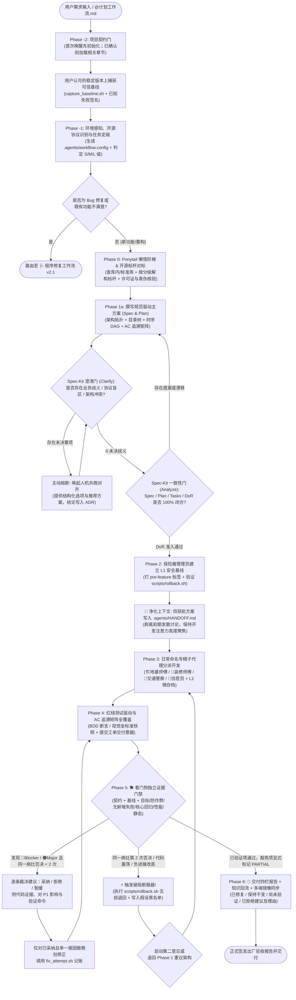

# 通用工业级软件工程与多智能体出厂验收工作流规范 (Spec-Driven & Watchdog Constitution)

> **文档代码**：`WORKFLOW_SPEC.md` / `计划工作流.md`  
> **版本**：`v3.1-Project-Aware`（与 [`程序修复工作流.md`](./程序修复工作流.md) `v2.1`、[`UI审美与开源组件借鉴工作流.md`](./UI审美与开源组件借鉴工作流.md) `v1.1` 组成三位一体工作流体系；共用 [`项目适配与契约初始化工作流.md`](./项目适配与契约初始化工作流.md) 与 [`项目契约模板.md`](./项目契约模板.md)）  
> **适用范围**：跨语言、跨技术栈（Python / Go / Rust / Node / 前端 / 移动端 / 嵌入式 / 全栈微服务）通用工程开发、模块演进与多智能体（Multi-Agent）协同流水线。  
> **设计目标**：**零玄学编程 (Anti-Vibe-Coding)**、**分级敏捷防僵化 (S/M/L Tiered Agility)**、**反炫技手搓与开源合规 (Ponytail & FOSS Guard)**、**防作弊量化验收 (Anti-Tampering AC)** 与 **双保险无损回滚 (Lossless Rollback)**。  
> **最高执行效力**：任何 Agent 或团队成员被 `@计划工作流.md` 唤醒或承接工程任务时，必须**先执行项目适配与契约初始化工作流**，加载该项目的 `.agents/PROJECT_CONTRACT.md`。本文档规定通用流程，项目契约规定第一要义、质量排序、设计意图、保护项与证据标准；两者冲突时，停止自动修改代码，向用户呈交具体证据与代价，由用户裁决或显式修订契约。严禁擅自跳步、篡改证据、无快照动工，或在契约未确认、可信基线缺失时宣布出厂。

---

## 目录 (Table of Contents)

1. [规范地位、九大军规与任务分级路由 (Constitutional Charter & Task Tiering)](#1-规范地位九大军规与任务分级路由-constitutional-charter--task-tiering)
2. [环境感知、开源协议识别与状态目录初始化 (Phase -1: Context Auto-Discovery)](#2-环境感知开源协议识别与状态目录初始化-phase--1-context-auto-discovery)
3. [Ponytail 懒惰阶梯、开源标杆对标与供应链安全 (Phase 0: Laziness Ladder & Prior-Art)](#3-ponytail-懒惰阶梯开源标杆对标与供应链安全-phase-0-laziness-ladder--prior-art)
4. [规范驱动总纲、Spec-Kit 双门禁与人机共商 (Phase 1: Spec-Driven Plan & Clarify/Analyze Gates)](#4-规范驱动总纲spec-kit-双门禁与人机共商-phase-1-spec-driven-plan--clarifyanalyze-gates)
5. [全生命周期三级存档与防灾无损回滚体系 (Phase 2: Three-Tier Checkpointing & Rollback)](#5-全生命周期三级存档与防灾无损回滚体系-phase-2-three-tier-checkpointing--rollback)
6. [日常命名专精子代理天团与上下文隔离 (Phase 3: Everyday-Named Subagent Taskforce)](#6-日常命名专精子代理天团与上下文隔离-phase-3-everyday-named-subagent-taskforce)
7. [量化验收指标、AC 追溯矩阵与缺陷分级 (Phase 4: Quantitative AC & Traceability Matrix)](#7-量化验收指标ac-追溯矩阵与缺陷分级-phase-4-quantitative-ac--traceability-matrix)
8. [独立看门狗五道门禁、防作弊审计与破局断路器 (Phase 5: Watchdog 5-Gate & Circuit-Breaker)](#8-独立看门狗五道门禁防作弊审计与破局断路器-phase-5-watchdog-5-gate--circuit-breaker)
9. [分级工业交付物闭环与多端镜像一致性保护 (Phase 6: Tiered Deliverables & Parity Guard)](#9-分级工业交付物闭环与多端镜像一致性保护-phase-6-tiered-deliverables--parity-guard)
10. [附录：通用 Agent 分级执行打卡清单 (Tiered Execution Checklists)](#10-附录通用-agent-分级执行打卡清单-tiered-execution-checklists)
11. [项目契约、审查建议裁决与知识回流 (Project Contract & Review Adjudication)](#11-项目契约审查建议裁决与知识回流-project-contract--review-adjudication)

---

## 1. 规范地位、九大军规与任务分级路由 (Constitutional Charter & Task Tiering)

传统大模型编程最常见的失败陷阱是：**“随意堆砌代码（Vibe Coding）导致上下文过长产生幻觉”、“无视标准库从零手搓脆弱轮子”、“单体通吞忽略边缘边界”、“遇到报错盲目乱改甚至删改测试骗绿灯”、“新改动破坏旧功能导致效果退步（Regression）”** 以及 **“回滚时把已提交或未提交的探索成果抹掉”**。

本规范融合 **GitHub Spec-Kit 规范驱动开发**、**Ponytail 反过度设计阶梯**、**Anthropic 上下文隔离最佳实践** 与 **多智能体看门狗治理体系**，在研发全周期设立确定性护栏。

### 1.1 核心执行九大军规 (The Nine Non-Negotiables)

```
┌─────────────────────────────────────────────────────────────────────────────────┐
│                    【核心执行九大军规 (The Nine Non-Negotiables)】             │
├─────────────────────────────────────────────────────────────────────────────────┤
│ 1. 严禁炫技手搓：动工前未爬完 Ponytail 六级懒惰阶梯、未按分级完成标杆对标者，不准动工│
│ 2. 严禁单体混战：M/L 级任务未按职责拆分子代理、未在计划批准后净化上下文者，不准动工│
│ 3. 严禁无快照动工：修改任何代码前未打安全基线快照、未验证 ./scripts/rollback.sh 不准动工│
│ 4. 严禁违规引包：未核验宿主开源协议兼容性、未核查幻觉包名（Slopsquatting）不准引包│
│ 5. 严禁模糊验收：没有 AC 追溯矩阵与自动化断言测试（或视觉金标准快照）者，不准交付│
│ 6. 严禁篡改测试：严禁通过删改既有测试、弱化断言、注入 skip/exit(0) 骗取门禁绿灯。│
│ 7. 严禁自我包庇：未经独立白纸上下文的“看门狗”跑通五道门禁签字者，不准宣布出厂。  │
│ 8. 严禁无项目语境动工：契约未 CONFIRMED、反直觉设计未理解、可信基线未捕获，不准动工│
│ 9. 严禁照单全收：看门狗/代码审查建议只是待验证假设，必须逐条裁决并记录证据。      │
└─────────────────────────────────────────────────────────────────────────────────┘
```

### 1.2 双工作流协同路由与 S / M / L 任务分级 (Task Tiering & Routing)

为避免“小改动走重流程导致 Agent 偷偷跳步”，所有工程任务在入口处按规模分为 **S / M / L** 三级，并与 [`程序修复工作流.md`](./程序修复工作流.md) 双向联动：

| 任务等级 | 判定标准（同时满足） | 流程与调研配额 | 交付物裁剪要求 |
| :--- | :--- | :--- | :--- |
| **🟢 S 级（轻量特性/微调）** | • 涉及 **$\le 2$ 个文件** 且净增改 **$\le 50$ 行**<br/>• 不新增外部依赖、不改变公共接口或数据库 Schema | • Phase 0：仅爬 Ponytail 前 5 级（查库内与标准库），免外部 GitHub 标杆报告<br/>• Phase 3：单专精角色直通开发 + 独立看门狗终审 | 变更说明 + 新增 AC 测试用例 + 看门狗门禁绿灯报告 |
| **🟡 M 级（标准功能/模块）** | • 涉及 **3–8 个文件** 或净增改 **51–400 行**<br/>• 或引入新第三方依赖 / 新增独立接口 | • Phase 0：Ponytail 六级阶梯 + 深度解构 **至少 1–2 个** 开源标杆（限时 10 分钟内）<br/>• 完整执行 Phase -1 ➔ Phase 6 | 完整代码与 AC 矩阵 + 更新 `README.md` 与架构/配置说明 |
| **🔴 L 级（核心系统/重大重构）** | • 涉及 **$>8$ 个文件**、跨模块并发/状态架构、核心协议或 Schema 迁移 | • Phase 0：Ponytail 六级阶梯 + 深度解构 **至少 3 个** 顶尖开源标杆<br/>• 全套子代理物理隔离流水线 + 微存档推进 | 全景 6 大工业级交付文档闭环 + 物理发布目录镜像同步 |

> **三工作流协同切换规则**：
> - **所有任务的第一入口**：先执行 [`@项目适配与契约初始化工作流.md`](./项目适配与契约初始化工作流.md)；契约已确认时只读取相关章节，不再重复询问。
> - **前端 / UI 审美与微交互任务**：仅在契约第 7 章启用 UI 规则时，唤醒 [`@UI审美与开源组件借鉴工作流.md`](./UI审美与开源组件借鉴工作流.md)；组件库与音效只是候选，必须服从项目第一要义，契约已经回答的问题不得重复询问。
> - **Bug 修复与效果纠偏任务**：若任务是**修复既有 Bug、解决性能退步、或对已交付功能效果不满意**，直接转入 [`程序修复工作流.md`](./程序修复工作流.md)（由 🏥 分诊台与 🕵️ 侦探接管）。
> - **联调缺陷微创闭环**：若在 Phase 5 联调中看门狗发现局部缺陷，直接调用 [`程序修复工作流.md`](./程序修复工作流.md) 的微创手术与五道门禁闭环。
> - **用户显式豁免（Explicit Waiver）**：若用户明确指定跳过某环节，Agent 必须在 `.agents/decisions/ADR-xxx.md` 记录 `[WAIVED BY USER]` 后方可执行。

### 1.3 全流程端到端状态机



---

## 2. 环境感知、开源协议识别与状态目录初始化 (Phase -1: Context Auto-Discovery)

作为跨语言通用工作流，进入任何项目时必须首先自动探测宿主环境，并将探测结果持久化至 `.agents/workflow.config`，供全体子代理与门禁脚本读取。

### 2.0 项目契约门与可信基线 (Phase -2: Contract & Baseline Gate)

在 Phase -1 前执行 [`@项目适配与契约初始化工作流.md`](./项目适配与契约初始化工作流.md)：契约不存在或状态不是 `CONFIRMED` 时，只读探索、生成 `DRAFT`、一次一个高影响问题、用户确认后纳入 Git；已确认时只加载本次任务相关章节。契约必须明确第一要义、质量排序、核心链路、反直觉设计原因与不变量。

随后在用户认可的稳定版本上运行 `./scripts/capture_baseline.sh <stable-ref>`，记录全量测试、失败签名、核心回归、冒烟、静态检查与性能数值。契约、证据命令、阈值和稳定版本未变化时复用同一基线，不要求每个小任务重捕。基线不可用、证据命令变更或契约仍含占位符时，禁止修改业务代码；`workflow.config` 至少包含 `CONTRACT_PATH`、`TEST_CMD`、`CORE_REGRESSION_CMD`、`SMOKE_CMD`、`LINT_CMD`、`BENCH_CMD`、`BENCH_THRESHOLD`、`BENCH_HIGHER_IS_BETTER`、`PERF_CRITICAL`。缺失命令必须进入“尚未验证清单”，不得以 `N/A` 冒充通过。

### 2.1 自动感知五要素探测表

| 探测维度 | 自动扫描特征文件 | 自适应策略与持久化配置字段 |
| :--- | :--- | :--- |
| **1. 语言与运行时** | `package.json` (Node/TS), `pyproject.toml`/`requirements.txt` (Python), `go.mod` (Go), `Cargo.toml` (Rust), `pom.xml` (Java), `CMakeLists.txt` (C++) | 写入 `PROJECT_LANG` 与 `LINT_CMD`，自动选定对应语法解析器与静态检查器。 |
| **2. 宿主开源许可证** | `LICENSE`, `LICENSE.md`, `COPYING`, `pyproject.toml`/`package.json` 中的 `license` 字段 | 写入 `PROJECT_LICENSE`（如 `MIT`, `Apache-2.0`, `GPL-3.0`）；若无许可证文件则记为 `UNLICENSED`，作为 Phase 0 借用外部代码的合规基准。 |
| **3. 测试与视觉框架** | `pytest`/`unittest`, `vitest`/`jest`/`playwright`, `go test`, `cargo test` | 写入 `TEST_DIR` 与 `TEST_CMD`，将 Phase 4 的 AC 断言自动适配到项目既有测试框架。 |
| **4. 包与依赖锁文件** | `pnpm-lock.yaml`/`package-lock.json`, `uv.lock`/`poetry.lock`, `go.sum`, `Cargo.lock` | 严禁全局污染安装，强制锁定版本并接入漏洞审计工具。 |
| **5. 版本控制与非 Git 退化** | `.git/`, 当前分支, 最新 Tag, 未暂存状态 | 写入 `BASE_BRANCH`；若当前目录非 Git 仓库，询问用户是否 `git init`，若拒绝则自动启用 `.agents/snapshots/` 目录级快照退化模式。 |
| **6. 项目契约与可信基线** | `.agents/PROJECT_CONTRACT.md`, `.agents/baseline/manifest.env`, 既有 `AGENTS.md` | 写入 `CONTRACT_PATH` 与证据命令；确认状态为 `CONFIRMED` 且基线 SHA、失败签名与证据命令一致。 |

---

## 3. Ponytail 懒惰阶梯、开源标杆对标与供应链安全 (Phase 0: Laziness Ladder & Prior-Art)

在编写业务代码前，必须杜绝两种极端：**一是无视现成标准库闭门造车手搓几百行脆弱代码；二是盲目引入许可证冲突或 AI 幻觉捏造的恶意依赖包**。

### 3.1 第一步：攀爬 Ponytail 六级懒惰阶梯 (`DietrichGebert/ponytail`)

任何功能模块在立项或选型前，**🧐 借用审查员**必须先进行“最懒资深工程师”六级拷问：
1. **真的需要写吗？** 能否通过删减伪需求或配置项直接解决？
2. **当前仓库里已经有了吗？** 全局检索项目既有 `utils` / `common` / `components`，严禁同库重复造轮子。
3. **语言标准库原生支持吗？** 标准库能解决的，**严禁手搓，也严禁额外引第三方包**。
4. **平台/浏览器原生支持吗？** 优先使用现代 Web / OS 原生 API。
5. **已安装的依赖包里自带了吗？** 优先复用 Lockfile 中已存在的成熟库。
6. **必须引入新外部方案或自研吗？** 仅当前 5 级均否定，才进入 3.2 开源标杆对标与合规引入流程。

### 3.2 第二步：分级开源标杆深度对标（带时间盒约束）

- **配额与时间盒（Timebox）**：
  - **S 级任务**：完成 3.1 内部与标准库核查即可，跳过外部 GitHub 标杆报告。
  - **M 级任务**：检索并解构 **1–2 个** 成熟开源项目，调研耗时控制在 **10 分钟 / 5 次检索调用** 以内，防止陷入无限调研瘫痪（Analysis Paralysis）。
  - **L 级任务**：深度解构 **至少 3 个** 行业高 Star / 高活跃度标杆项目。
- **三维解构与采纳策略（Adopt / Adapt / Avoid）**：

| 采纳策略 | 适用场景 | 落地要求 |
| :--- | :--- | :--- |
| **直接借用/引入 (Adopt)** | 机制极度成熟、契合度高，且**开源许可证与本项目 `PROJECT_LICENSE` 完全兼容**。 | 直接引入合规包或借用核心模块，保留完整 Copyright 与 License 声明。 |
| **提炼改良 (Adapt)** | 架构设计优秀，但原实现绑定了沉重运行时或其协议（如 GPL）与本项目（如 MIT）不兼容。 | **仅汲取其宏观架构思想与通用算法流程（思想非版权客体），坚决不复制其源码**，用本项目原生技术栈独立编写。 |
| **反面规避 (Avoid)** | 标杆项目中已被社区证实存在内存泄漏、并发死锁或过度设计的做法。 | 在本方案中明确设立红线防御机制与边界断言。 |

### 3.3 第三步：开源项目许可证兼容与防“幻觉包投毒”（Slopsquatting Guard）

由于你的项目通常为**开源项目**，引入依赖或借用代码必须通过以下双重安全审查：

1. **开源许可证传染防御矩阵**：
   - 若本项目为宽松开源协议（**MIT / Apache-2.0 / BSD**）：✅ 允许借用 MIT / BSD / ISC / Apache-2.0 代码（保留版权头与 NOTICE）；⚠️ MPL-2.0 / LGPL 仅限外部包动态调用，禁止直接复制源码混入核心文件；🔴 **绝对禁止复制 GPL / AGPL 代码或无 LICENSE 仓库代码**，防止本项目被迫传染变更协议或构成侵权。
   - 若本项目本身为 **GPL-3.0**：🟢 允许兼容引入 MIT / Apache-2.0 / LGPL / GPL-3.0 代码；🔴 仍需拦截 AGPL-3.0（网络传染）与无 LICENSE 专有代码。
2. **防 AI 幻觉包名投毒（Anti-Slopsquatting）三查准入**：
   - **一查存在性**：向 PyPI / npm / crates.io 官方接口确认包名真实存在、非近期抢注空壳包；
   - **二查已知漏洞**：运行 `pip-audit` / `npm audit` / `osv-scanner` 确认 0 高危漏洞；
   - **三锁版本哈希**：强制写入项目 Lockfile。

---

## 4. 规范驱动总纲、Spec-Kit 双门禁与人机共商 (Phase 1: Spec-Driven Plan & Clarify/Analyze Gates)

严禁在没有清晰规格书（Spec）的情况下直接写代码。本阶段引入 **GitHub Spec-Kit** 的标准化质量门禁。

### 4.1 实施总纲 (Master Spec Plan) 必备四大板块

1. **系统分层架构拓扑图**：使用标准 Mermaid 图（`flowchart TD` 或 `sequenceDiagram`）刻画数据流、控制流与模块边界。
2. **影响文件目录拓扑树 (Directory Topology)**：列出所有新增、修改、删除文件的精确路径、单一职责说明，严禁循环依赖。
3. **步骤时序执行 DAG (Directed Acyclic Graph)**：明确每一步的前置依赖、负责的专精子代理、核心技术手段及自检命令。
4. **风险预案与 AC 量化追溯初稿**：标识高危改动点（如公共接口变更、数据迁移）并绑定对应的验收指标编号（`AC-01`, `AC-02`...）。

### 4.2 Spec-Kit 质量第一门：澄清门与人机共商协议 (The Clarify Gate)

“不懂装懂、自行假设”是返工的第一元凶。在方案提交前必须过 **Clarify 澄清门**，严格执行**“三不猜”原则**：
- **业务需求与审美预期不猜**：当交互表现、视觉排版或业务分支存在多种理解时；**凡涉及前端界面，必须在此阶段主动询问用户是否需要开启交互音效（同声传译、语音识别、录音等音频敏感项目默认强制锁死禁音）**；
- **项目质量优先级与反目标不猜**：契约未给出排序、指标或冲突裁决原则时，一次只问一个最高影响问题，不依据项目类型自动套用固定优先级；契约已经确认的答案不得重复询问；
- **第三方协议与环境盲区不猜**：遇到外部接口限流、平台差异或未公开行为时；
- **破坏性架构权衡不猜**：当性能、开发成本与可维护性出现重大取舍冲突时。

**共商对齐与 ADR 落盘规范**：触发任一条件时，主动向用户抛出结构化对齐单（**① 客观现状、② 候选方案对比、③ 带论据的首选推荐**）。用户拍板后，必须将决议写入 `.agents/decisions/ADR-xxx.md`，防止后续会话遗忘。

### 4.3 Spec-Kit 质量第二门：一致性核对门与开工准入清单 (Analyze Gate & Definition of Ready)

在进入 Phase 2 动工前，必须执行静态交叉核对（Analyze Gate），满足以下 **Definition of Ready (DoR) 五项准入标准** 方可动工：

```
┌─────────────────────────────────────────────────────────────────────────────────┐
│                【开工准入铁门清单 (Definition of Ready - DoR)】                 │
├─────────────────────────────────────────────────────────────────────────────────┤
│ [ ] 1. 零未决问题：所有 Clarify 澄清项已由用户拍板，并记入 .agents/decisions/。 │
│ [ ] 2. 双向全映射：每一条用户需求均已映射到具体的 AC-XX 指标，且每个 AC-XX 均已 │
│        指定对应的自动化测试文件路径（无悬空需求、无无主任务）。                 │
│ [ ] 3. 反手搓签批：借用审查员已确认方案通过 Ponytail 阶梯与开源许可证兼容审查。 │
│ [ ] 4. 边界无冲突：各专精子代理负责的文件集合互不重叠，无并发写同一文件冲突。   │
│ [ ] 5. 用户已批准：主方案已获得用户明确确认同意（Approve）。                    │
│ [ ] 6. 契约已确认：PROJECT_CONTRACT.md 为 CONFIRMED，本次影响的质量排序、       │
│        核心链路、反直觉设计原因、不变量与证据命令已读取。                       │
│ [ ] 7. 可信基线已捕获：capture_baseline.sh 记录稳定 SHA、已知失败签名、        │
│        核心回归 / 冒烟 / 静态 / 性能证据，且证据命令未被事后修改。             │
└─────────────────────────────────────────────────────────────────────────────────┘
```

---

## 5. 全生命周期三级存档与防灾无损回滚体系 (Phase 2: Three-Tier Checkpointing & Rollback)

在工程迭代中，最灾难的场景莫过于：**“改完发现不如上一版，回滚时却把刚刚探索的已提交或未提交代码彻底冲刷抹掉了”**。

### 5.1 三级安全存档架构 (Three-Tier Checkpointing Architecture)

| 存档层级 | 触发时机 | 标准标签/分支命名 | 核心恢复能力 |
| :--- | :--- | :--- | :--- |
| **L1. 开工前基线快照**<br/>*(Pre-flight Baseline)* | Phase 2 动手修改任何业务文件前强制触发 | `pre-feature-<模块>-<YYYYMMDD>`<br/>（修复时为 `pre-fix-<id>-<YYYYMMDD>`） | 一键回到完全未动工前的干净可用状态。 |
| **L2. 里程碑微存档**<br/>*(Micro-Checkpoint)* | Phase 3 每个专精子代理完成独立子任务并通过单测后触发 | `checkpoint-<模块>-step<N>-ok` | 后续子任务出错时，只需退回到上一个绿灯微存档，无需推倒重来。 |
| **L3. 出厂物理归档**<br/>*(Release-Safe Archive)* | Phase 5 已验证项通过且豁免项显式标记 `PARTIAL`、Phase 6 镜像校验通过后触发 | `vX.Y-<feature>-stable` + 独立发布目录冷备 | 生产级稳定基线，随时可供外部发布或作为下一轮迭代的对比基准。 |

### 5.2 双保险防灾回滚脚本（[`scripts/rollback.sh`](./scripts/rollback.sh)）

项目根目录配备与《程序修复工作流》共用的实测级 [`./scripts/rollback.sh`](./scripts/rollback.sh)，内置三大防蒸发机制：

1. **已提交尝试锁定（`rescue/head_<时间戳>`）**：执行 `git reset --hard` 前，脚本强制先将当前 `HEAD` 锁定到 `rescue/head_<时间戳>` 分支——即便 Agent 已经在分支上 Commit 了多次修改，回滚后这些提交也 100% 挂在救援分支上，绝不变成孤儿提交蒸发。
2. **未提交碎片封存（`rescue/wip_<时间戳>`）**：若工作区有未提交改动，自动封存至 `rescue/wip_<时间戳>` 分支。
3. **核心资产严格白名单保护**：自动保护 `.env*`、`*.key`、`*.pem`、`*.token`、`.venv`、`node_modules`、`.agents/`、`release/`、`正式版/`、`归档/`、`scripts/` 与 `tests/test_repro_*` 绝不被清理。

```bash
# 常用安全回滚命令（支持先预演再执行）
./scripts/rollback.sh --list                             # 查看所有可用基线与救援分支
./scripts/rollback.sh pre-feature-auth-20261024 --dry-run # 预演回滚，不修改任何文件
./scripts/rollback.sh pre-feature-auth-20261024           # 秒级无损退回指定基线
```

---

## 6. 日常命名专精子代理天团与上下文隔离 (Phase 3: Everyday-Named Subagent Taskforce)

大型任务若交给单一 Agent 在同一个冗长会话里从头写到尾，必因上下文膨胀、注意力耗散而顾此失彼。本工作流强制采用**日常直观命名、职责物理隔离**的专精子代理天团（与《程序修复工作流》共享治理角色）：

### 6.1 日常命名专精子代理角色矩阵

```
┌─────────────────────────────────────────────────────────────────────────────────┐
│                【计划工作流：日常命名专精子代理天团角色矩阵】                    │
├───────────────────────────┬─────────────────────────────────────────────────────┤
│ 子代理日常名称 (代号)     │ 职责领地与绝对越界红线                              │
├───────────────────────────┼─────────────────────────────────────────────────────┤
│ 1. 🏗️ 地基师傅            │ 负责底层核心计算、数据结构、存储内核、并发调度与    │
│    (CoreEngine)           │ 算法实现；严禁越界修改前端 UI 样式或外层路由网关。  │
├───────────────────────────┼─────────────────────────────────────────────────────┤
│ 2. 🎨 装修师傅            │ 负责前端页面、客户端窗口、排版留白、动效与无障碍交互│
│    (ClientUI)             │ 专注零抖动、自适应折行、无意外滚动条；严禁改数据库。│
├───────────────────────────┼─────────────────────────────────────────────────────┤
│ 3. 🚦 交通警察            │ 负责 API 路由通信、网络协议、鉴权流控、超时重试与   │
│    (GatewayAPI)           │ 配置持久化；严格保障接口契约一致性与过载保护。      │
├───────────────────────────┼─────────────────────────────────────────────────────┤
│ 4. 🧨 找茬员              │ 负责黑盒对抗注入：弱网断连、并发竞态、畸形参数攻击、│
│    (AdversarialQA)        │ 极限窗口尺寸压力测试；专职“吹毛求疵、故意搞崩系统”。│
├───────────────────────────┼─────────────────────────────────────────────────────┤
│ 5. 📝 书记员              │ 负责零 AI 味工业级文档、小白部署手册、架构说明及    │
│    (ReleaseDoc)           │ 根目录与发布目录（如 release/、正式版/）镜像核验。  │
├───────────────────────────┼─────────────────────────────────────────────────────┤
│ 6. 🔭 美学星探   [共用] │ 仅在契约启用 UI 规则时绑定 @UI审美工作流；先查项目 │
│    (Aesthetic Scout)      │ 设计系统，再按需提纯候选 UI/动效原语与音效能力。    │
│ 7. 🦺 保险箱管理员 [共用] │ 负责 L1/L2/L3 三级快照打标与 scripts/rollback.sh 回滚│
│ 8. 🧐 借用审查员   [共用] │ 负责 Ponytail 六级懒惰阶梯、开源协议兼容与引包审计。│
│ 9. 🐕 看门狗       [共用] │ 独立白纸上下文执行五道门禁与防作弊审计，持一票否决权│
│ 10.⚡ 破局断路器   [共用] │ 监控 2 次否决与代码震荡，强制拉闸回滚并启动第二意见│
└───────────────────────────┴─────────────────────────────────────────────────────┘
```

### 6.2 上下文净化与子代理交接铁律 (Anthropic Fresh-Context Pattern)

1. **计划批准后净化上下文**：当 Phase 1 的主方案获得用户批准后，先将主方案、文件边界与 AC 矩阵写入 `.agents/HANDOFF.md`，然后**开启全新干净会话（或召唤独立子代理）** 启动 Phase 3 编码。前期长达数千 Token 的探索废话绝不带入编码上下文。
2. **单一职责与写范围锁定**：每个子代理只准修改分配给它的目录与文件列表。
3. **标准化《工单交付票据》(Handover Ticket)**：子代理完成子任务并打好 L2 微存档（`checkpoint-*-ok`）后，必须向统筹层提交如下票据：
   ```markdown
   ### 🎫 子代理工单交付票据 (Subtask Handover Ticket)
   - **执行角色**：🎨 装修师傅 (ClientUI) | **微存档标签**：`checkpoint-ui-step2-ok`
   - **修改文件列表**：`src/components/Sidebar.tsx`, `src/styles/layout.css`
   - **对应 AC 编号**：`AC-03`, `AC-04`
   - **自测执行证据**：`npx playwright test tests/test_ac_03_sidebar.spec.ts` ➔ 2 passed (1.4s)
   ```

---

## 7. 量化验收指标、AC 追溯矩阵与缺陷分级 (Phase 4: Quantitative AC & Traceability Matrix)

拒绝“应该挺快”、“感觉界面还行”等主观臆断。每一项需求必须转化为**机器可断言的量化指标（AC）**。

### 7.1 四大黄金量化维度

| 评估维度 | 核心关注点 | 机器可断言客观指标范例 |
| :--- | :--- | :--- |
| **1. 性能与时延 SLA** | 执行效率、响应耗时、高并发吞吐 | • 核心计算/切片处理 P99 耗时严格 $< X\text{ms}$。<br/>• 高频数据流下缓冲队列无丢包、无阻塞挂起。 |
| **2. 资源与内存稳定性** | 长期运行无泄漏、句柄开销恒定 | • 连续高频负载运行 $N$ 轮后，常驻内存增长率收敛（无单调线性泄漏）。<br/>• 列表/日志渲染节点设有环形上限，DOM/文件句柄数不随时间无限膨胀。 |
| **3. 交互与视觉金标准** | 视觉排版、自适应折行、金标准快照 | • 容器严禁出现意外原生滚动条（`overflow: hidden`）。<br/>• 极限缩放下文字自适应折行并保持呼吸留白，0 次半行切边。<br/>• 关键界面通过 Playwright `toHaveScreenshot()` 金标准像素比对（误差 $\le 1\%$）。 |
| **4. 容灾与健壮性** | 弱网断网、空值/越界攻击、超时隔离 | • 畸形/空参数输入 100% 优雅拦截并返回结构化错误码，0 未捕获崩溃。<br/>• 下游慢响应或断连时，超时熔断在规定时间内触发，不拖垮主线程。 |

### 7.2 规范化 BDD 描述与 AC 双向追溯矩阵 (AC Traceability Matrix)

每个 AC 采用 `GIVEN - WHEN - THEN` 格式定义，并在主方案与验收报告中维护如下**双向追溯矩阵**（严禁出现没有绑定测试脚本的“裸奔 AC”）：

| AC 编号 | 需求模块 | GIVEN (前置条件) | WHEN (触发动作) | THEN (量化预期断言) | 绑定自动化测试脚本路径 | 门禁状态 |
| :--- | :--- | :--- | :--- | :--- | :--- | :--- |
| `AC-01` | 缓存引擎 | 容量上限设为 10 | 连续写入 100 条键值 | 缓存长度严格为 10，最旧键被淘汰 | `tests/test_ac_01_cache.py` | `[✅ PASS]` |
| `AC-02` | 弹窗排版 | 视口宽度 768px | 注入 2000 字长文本 | 宽度 $\le 640\text{px}$，`overflowX == hidden` | `tests/test_ac_02_modal.spec.ts` | `[✅ PASS]` |

### 7.3 缺陷严重度三级裁决制（杜绝因细枝末节陷入死循环）

为避免“因为一处注释格式或次要命名就无限打回重做导致死循环”，验收缺陷实行三级分流：

```
┌─────────────────────────────────────────────────────────────────────────────────┐
│              【验收缺陷三级裁决制 (Defect Severity Triage)】                     │
├──────────────────────┬───────────────────────────────────┬──────────────────────┤
│ 缺陷等级             │ 判定准则                          │ 门禁动作与试错计次   │
├──────────────────────┼───────────────────────────────────┼──────────────────────┤
│ 🔴 Blocker (致命阻断)│ 任一 AC 断言失败、历史回归失败、  │ 立即一票否决打回！   │
│                      │ 篡改测试文件、崩溃或安全合规红线  │ 计入断路器试错 (+1)  │
├──────────────────────┼───────────────────────────────────┼──────────────────────┤
│ 🟠 Major (严重缺陷)  │ 明显边界漏判、资源泄漏、性能劣化  │ 一票否决打回！       │
│                      │ 超阈值、或越界修改了无关模块代码  │ 计入断路器试错 (+1)  │
├──────────────────────┼───────────────────────────────────┼──────────────────────┤
│ 🟡 Minor (轻微瑕疵)  │ 局部注释措辞、非公开变量命名风格、│ 不阻断出厂！放行通过 │
│                      │ 不影响功能与视觉契约的次要优化项  │ 记入遗留优化单 (+0)  │
└──────────────────────┴───────────────────────────────────┴──────────────────────┘
```

---

## 8. 独立看门狗五道门禁、防作弊审计与破局断路器 (Phase 5: Watchdog 5-Gate & Circuit-Breaker)

### 8.1 看门狗“项目语境白纸输入包”隔离规范 (Context-Aware Clean-Room Observer)

看门狗（**🐕 The Watchdog**）必须是在**全新独立上下文**中唤醒的第三方角色，严禁由编写代码的子代理兼任。白纸视角排除开发者的推理辩解，但不排除项目长期事实；唤醒时提供**七件套输入包**：
1. Phase 1 批准的《主方案与 AC 追溯矩阵》；
2. 净代码变更 `git diff <pre-feature-tag> HEAD`；
3. 项目契约相关章节（第一要义、P1–P3、核心链路、反直觉设计、证据命令）；
4. `.agents/decisions/` 中相关 ADR 与 `.agents/baseline/manifest.env` 可信基线记录；
5. `.agents/workflow.config`；
6. 稳定基线标签与已知失败签名；
7. 独立门禁脚本 [`./scripts/watchdog_gate.sh`](./scripts/watchdog_gate.sh)。

看门狗输出的是待验证审查建议，不是无条件执行命令。每条建议必须写明证据、影响的契约条款与建议验证方式；若建议会破坏“必须保持的行为”或改变反直觉设计，必须标记为需要裁决，禁止直接要求主刀医生照改。

### 8.2 看门狗独立五道门禁（含防作弊测试篡改审计）

看门狗亲自运行 `./scripts/watchdog_gate.sh <复现或AC测试> <pre-feature-tag>`，先过**门禁 0**再依次审计五道关卡：
- **门禁 0（Exit 106 / 107）**：契约必须为 `CONFIRMED`、无占位符；可信基线、契约哈希、失败签名、证据命令、性能阈值与方向必须一致；基线中已配置的核心回归、冒烟、静态检查必须通过，未配置项进入未验证清单。
- **门禁 1（Exit 101）—— 新增 AC 断言全绿**：AC 追溯矩阵中所有新增测试 100% 通过。
- **门禁 2（Exit 104）—— 防作弊与证据篡改审计（Anti-Reward-Hacking）**：
  - 自动检查 `git diff --name-status <base-tag> -- tests/`：**严禁开发者未经人类授权（`ALLOW_TEST_EDIT=1`）修改或删除既有测试文件**；
  - 自动扫描新增代码行：**严禁注入 `.skip(`、`@pytest.mark.skip`、`xfail`、`.only(`、`sys.exit(0)`** 等逃逸指令；
  - 自动核查契约、基线证据与 `workflow.config` 未被静默修改；**严禁针对测试输入写死 `if input == "test_case": return expected` 等投机特判代码**。
- **门禁 3（Exit 102）—— 历史全量零新增失败**：与基线失败签名对比，只允许已确认的既有失败，0 新增失败。
- **门禁 4（Exit 103 / 108）—— 核心不退化与性能数值对照**：已配置的 `CORE_REGRESSION_CMD` 和 `SMOKE_CMD` 必须通过，未配置项进入未验证清单；`BENCH_CMD` 最后一行数值与基线按项目阈值比较，`PERF_CRITICAL=1` 时不得缺失。
- **门禁 5（Exit 105）—— 静态与类型安全检查**：Linter 与编译类型检查 0 错误。

缺失证据命令进入尚未验证清单；用户显式设置 `ALLOW_UNVERIFIED=1` 并记录 ADR 时结论为 `PARTIAL`，否则 Exit 106。只有已验证项全绿且无豁免项才输出 `PASS`。

### 8.3 破局断路器（Circuit-Breaker Pattern）统一跳闸规则

当联调或排障进入以下任一红线状态时，**⚡ 破局断路器**立即强制拉闸（与《程序修复工作流》完全一致）：

1. **同一病灶连续 2 次被看门狗否决**（请求第 3 次尝试时 `fix_attempt.sh` 自动返回 `Exit 202`）；
2. **检测到 `A ➔ B ➔ A` 代码震荡**（当前代码树与历史某次尝试完全一致，`fix_attempt.sh` 自动返回 `Exit 201`）；
3. **检测到重复错误假设**（返回 `Exit 203`）或单次修改引发 $\ge 2$ 项历史测试回归；
4. **单问题排障交互超过 25 轮工具调用**。

**跳闸强制处置动作**：
- 立即调用 `./scripts/rollback.sh` 退回至上一稳定微存档（`checkpoint-*-ok`）或开工基线（`pre-feature-*`）；
- 将已失败的假设写入 `.agents/HANDOFF.md` 的 **`[已证伪假设黑名单]`**；
- 启动 **第二意见通道**（开启全新上下文，或对 L 级任务用 `git worktree` 并行生成候选方案择优）；若第二意见依然失败，判定为架构设计冲突，退回 Phase 1 唤醒人机共商。

---

## 9. 分级工业交付物闭环与多端镜像一致性保护 (Phase 6: Tiered Deliverables & Parity Guard)

### 9.1 物理目录隔离与多端原子镜像同步 (Multi-Directory Parity Guard)

若项目维护有独立物理发布目录（如 `release/`、`dist/` 或 `正式版/`）：
- 核心代码、配置模板与文档的修改，**绝不能只停留在工作区根目录**；
- 在看门狗签署出厂前，📝 书记员必须校验根目录与发布目录的文件哈希指纹，确保 100% 原子镜像同步，杜绝“版本孤岛”。

### 9.2 零 AI 味工业级工程文档标准 (Zero-AI Cliché Standard)

所有工程交接文档、README 与注释，必须保持克制、客观、可复现的工业级技术文风：
- **严禁出现无信息量的 AI 过渡套话**（如空洞的寒暄、夸张的形容词自夸、机械的总结开场白）；
- **客观数据说话**：直接给出命令、参数表、时延指标（ms）、内存占用（MB）、架构 Mermaid 图与错误码速查表；
- **复制即用**：所有终端命令均经过实测，从环境准备到验证均可直接复制粘贴运行。

### 9.3 按 S / M / L 分级裁剪的交付物闭环清单 (Tiered Deliverables Matrix)

| 交付物名称 | 🟢 S 级任务 | 🟡 M 级任务 | 🔴 L 级任务 | 核心内容要求 |
| :--- | :---: | :---: | :---: | :--- |
| **1. 代码变更与 AC 测试套件** | ✅ 必交 | ✅ 必交 | ✅ 必交 | 含完整 `tests/` 自动化断言与看门狗五道门禁绿灯输出。 |
| **2. `README.md`** | 按需更新 | ✅ 必交 | ✅ 必交 | 项目架构全景、核心特性、快速上手指南。 |
| **3. `TECHNICAL_ARCHITECTURE.md`**| 免交 | 按需更新 | ✅ 必交 | 分层架构图、核心机制、API 协议契约与 ADR 决策索引。 |
| **4. `INSTALL.md` & `USER_GUIDE.md`**| 免交 | 涉及部署/UI时必交 | ✅ 必交 | 零基础部署步骤、环境变量说明、功能操作与快捷键指南。 |
| **5. `TROUBLESHOOTING.md`** | 免交 | 免交 | ✅ 必交 | 常见报错代码、端口冲突、环境异常排障决策树。 |
| **6. 验收报告与基准记录** | 终端摘要 | ✅ 必交 | ✅ 必交 | 包含 AC 追溯矩阵实测结果、防作弊审计结论与性能基准数据。 |

### 9.4 项目化交付报告四栏 (Project-Aware Delivery Report)

所有等级都必须给出四栏，禁止只报“测试全绿”：

| 栏目 | 必须提供的证据 |
| :--- | :--- |
| **已修复** | 目标 AC、复现脚本、对应补丁与门禁结果。 |
| **保持不变** | 契约第 3 章核心行为、稳定基线对照、性能与冒烟证据。 |
| **尚未验证** | 缺失命令、被豁免项、环境差异与具体风险；`PARTIAL` 不得写成 `PASS`。 |
| **已拒绝建议及理由** | 逐条列出审查建议、裁决、代码证据、对 P1 的影响；理由成立时回写契约第 4、8 章或 ADR。 |

---

## 10. 附录：通用 Agent 分级执行打卡清单 (Tiered Execution Checklists)

### 10.1 🟢 S 级任务（$\le 2$ 文件、$\le 50$ 行、无新依赖）极速打卡单

```markdown
- [ ] 1. [契约门] 已加载 `CONFIRMED` 项目契约的相关章节，并在用户认可稳定版上运行 `capture_baseline.sh`；缺失证据已显式豁免并记录 ADR。
- [ ] 2. [Phase -1/0] 已更新 `.agents/workflow.config`，确认库内与标准库无现成实现（Ponytail 前 5 级）。
- [ ] 3. [Phase 1/2] 已明确 AC 断言指标，打好 `pre-feature-*` 快照标签，验证 `./scripts/rollback.sh` 可用。
- [ ] 4. [Phase 3/4] 完成代码修改与对应 AC 自动化测试，未触碰无关文件与既有测试。
- [ ] 5. [Phase 5] 独立看门狗运行 `./scripts/watchdog_gate.sh <AC测试> <pre-feature-tag>`；已验证项全绿且无豁免为 `PASS`，豁免为 `PARTIAL` 并记录 ADR。
- [ ] 6. [Phase 6] 审查建议已逐条裁决，交付报告列出四栏，新增设计原因已回写契约或 ADR，再打稳定标签交付。
```

### 10.2 🟡 M 级 / 🔴 L 级任务完整标准打卡单

```markdown
### [ ] Phase -1: 环境感知与任务定级
- [ ] 已先完成 Phase -2 契约门与可信基线捕获；契约、基线 SHA、已知失败签名和证据命令一致。
- [ ] 已自动探测语言、测试框架、包管理器与宿主 `PROJECT_LICENSE`，写入 `.agents/workflow.config`。
- [ ] 已判定任务等级（M / L）；若非 Git 仓库已询问用户初始化或启用 `.agents/snapshots/` 模式。

### [ ] Phase 0: Ponytail 懒惰阶梯与开源标杆对标
- [ ] 已完成 Ponytail 六级懒惰阶梯核查，优先复用项目内代码与语言标准库。
- [ ] 已在时间盒内深度剖析开源标杆（M 级 1–2 个，L 级 >= 3 个），确立 Adopt / Adapt / Avoid 策略。
- [ ] 已完成开源许可证双向兼容核查（无 GPL/AGPL 传染或无证代码侵权）与新依赖真伪/漏洞核查（防 Slopsquatting）。

### [ ] Phase 1: 规范方案、Spec-Kit 双门禁与 DoR 准入
- [ ] 已绘制 Mermaid 架构图、目录拓扑树、执行时序 DAG 与 AC 双向追溯矩阵初稿。
- [ ] [Clarify 澄清门] 遇到业务歧义、协议盲区或架构冲突已主动唤起人机共商，决议已写入 `.agents/decisions/ADR-xxx.md`。
- [ ] [Analyze 一致性门] 已逐项通过 Definition of Ready (DoR) 七项准入标准，获得用户批准。

### [ ] Phase 2: 三级安全存档与防灾回滚
- [ ] 动工前已打 L1 基线标签（`pre-feature-xxx-日期`）。
- [ ] 已验证 `./scripts/rollback.sh --list` 可用，确认 `rescue/head_*` 与 `rescue/wip_*` 双重防蒸发机制就绪。

### [ ] Phase 3: 上下文净化与日常命名子代理派发
- [ ] 已将获批方案写入 `.agents/HANDOFF.md`，并在干净上下文中派发专精子代理（🏗️地基师傅 / 🎨装修师傅 / 🚦交通警察 / 🧨找茬员 / 📝书记员）。
- [ ] 每个子代理完成自测后已打 L2 微存档（`checkpoint-*-ok`）并提交《工单交付票据》。

### [ ] Phase 4: 量化验收与 AC 追溯矩阵闭合
- [ ] AC 追溯矩阵中的每一项指标均已绑定自动化断言测试（UI 类绑定几何断言或金标准视觉快照）。
- [ ] 全量测试执行通过；若发现退步（改恶），立即回滚至上一微存档基线。

### [ ] Phase 5: 看门狗白纸终审与破局断路器
- [ ] 已在独立白纸上下文唤醒 🐕 看门狗（投喂七件套项目语境输入包，不传开发者推理辩解）。
- [ ] 看门狗运行 `./scripts/watchdog_gate.sh <AC测试> <pre-feature-tag>`，门禁 0 与五道证据门禁无 🔴Blocker / 🟠Major；`PARTIAL` 豁免已记录 ADR。
- [ ] 所有审查建议已逐条裁决；一次只对一个经证明的根因做微创修改。
- [ ] 若同一病灶连续 2 次否决或发生 `A ➔ B ➔ A` 震荡，⚡ 断路器已强制调用 `./scripts/rollback.sh` 回滚并启动第二意见通道或升级共商。

### [ ] Phase 6: 分级交付物闭环与多端同步
- [ ] 若存在独立发布目录（`release/` 或 `正式版/`），已完成文件指纹比对与 100% 原子镜像同步。
- [ ] 按 S/M/L 分级矩阵完成零 AI 味工程文档闭环，打好 L3 正式稳定标签（`vX.Y-feature-stable`）。
- [ ] 交付报告已列出“已修复 / 保持不变 / 尚未验证 / 已拒绝建议及理由”，新知识已回写契约或 ADR。
```

## 11. 项目契约、审查建议裁决与知识回流 (Project Contract & Review Adjudication)

### 11.1 理解代码为什么这样写

只要求解释高风险、反直觉或核心链路中的代码。修改前，负责子代理必须回答五项并写入工单：`服务哪个契约目标`、`上下游依赖`、`为何采用当前写法`、`哪些既有行为必须不变`、`如何证明没有退化`。解释必须来自代码、测试、Git 历史、契约或用户确认；不得凭“看起来更标准”推断原实现是缺陷。

### 11.2 审查建议裁决门

借鉴 Superpowers 的 `receiving-code-review`：看门狗、静态工具和人类 reviewer 的建议统一进入裁决表，逐条给出 `采纳 / 拒绝 / 暂缓`、代码证据、对 P1 的影响、验证命令和必要的 ADR。以下情形默认拒绝并请求用户确认：破坏契约第 3 章不变量；把实时链路改成同步阻塞；无视第 4 章已记录的设计原因；一次打包多个无关修复；或建议缺乏可验证证据。

被拒绝且有长期价值的理由回写契约第 4 章，失败假设写入第 5 章，裁决证据写入第 8 章；已证实为缺陷的实现不得继续列为保护项。全局流程与契约冲突时，Agent 不得静默修改业务代码或契约，必须呈交客观现状、候选方案、各自代价与推荐方案，等待用户裁决。

### 11.3 知识分层与更新时机

长期知识（契约、ADR、fitness 资产、可复用回归测试）纳入 Git；过程数据（workflow.config、baseline 输出、HANDOFF、fix-log、expectations、snapshots）默认保持本地。新增核心约束、稳定版本变化、审查意见被拒绝且理由成立、事故复盘或用户修订第一要义时，按 [`@项目适配与契约初始化工作流.md`](./项目适配与契约初始化工作流.md) 第 8 节增量更新并重新捕获基线。

---

> **WEED PLAN.MD 通用计划工作流**  
> **版本**：`v3.1-Project-Aware` (跨语言即插即用通用版 + 项目契约层)  
> 历史版本由发布前的本地归档保存；公开版本的历史以本仓库 Git 记录为准。
