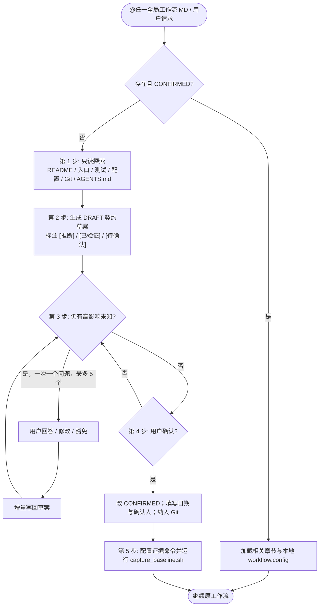

# 项目适配与契约初始化工作流 (Project Contract Bootstrap)

> **文档代码**：`PROJECT_ADAPTATION_WORKFLOW.md` / `项目适配与契约初始化工作流.md`  
> **版本**：`v1.0`  
> **定位**：三份全局工作流共用的第一入口。它不是第四套开发流程，而是把通用流程接入具体项目前，先建立“这个项目最在意什么、代码为何如此写、哪些行为不能退化”的契约层。  
> **落地形态**：全局模板保持不变；目标项目只生成 `.agents/PROJECT_CONTRACT.md`，需要时补充 ADR 与可执行回归资产。

---

## 1. 何时唤醒

以下任一条件成立时，Agent 必须先执行本工作流，再进入计划、修复或 UI 流程：

1. 当前项目不存在 `.agents/PROJECT_CONTRACT.md`。
2. 契约存在但 `contract_status` 不是 `CONFIRMED`，或仍有 `{{...}}` 占位符。
3. 仓库结构、第一要义、核心链路、稳定基线发生重大变化。
4. 用户明确说“初始化工作流”“重新评估项目重点”“生成项目专属工作流”。

若契约已 `CONFIRMED`，按任务读取相关章节，不得每次重新询问已确认内容。所有任务至少读取第 1、2、5 章；只要触及核心链路、反直觉设计或证据命令，就必须读取对应的第 3、4、6 章；涉及审查建议、审查裁决或知识回流时读取第 8 章；M/L 级任务读取全部相关章节。“S 级”不是跳过设计意图的授权。

## 2. 执行状态机



## 3. 第一步：先调查，后提问

只读扫描以下内容，并把结论连同来源路径写入契约第 0 章：

| 维度 | 优先读取 | 要回答的问题 |
| :--- | :--- | :--- |
| 项目意图 | `README*`、产品文档、`package.json` / `pyproject.toml` 描述字段、最近提交 | 项目交付什么价值，给谁用？ |
| 结构 | 入口文件、目录树、模块签名与导入关系 | 核心链路经过哪些文件和状态边界？ |
| 质量证据 | 测试、CI、基准脚本、监控、错误码、超时与重试配置 | 项目已经用什么证明“没坏”“够快”“安全”？ |
| 反直觉实现 | 缓存、锁、轮询、宽泛异常、兼容分支、手写算法、注释中的警告 | 哪些代码单看不标准，却可能服务于核心约束？ |
| 既有 Agent 规则 | `AGENTS.md`、嵌套 `AGENTS.md`、`.cursor/rules`、既有 `.agents/` | 用户已经明确过哪些规则？ |

禁止把目录名或关键词直接当成结论。例如看到“translation”不能自动断言时延优先于准确率；看到“game”不能自动断言所有安全校验优先于输入响应。

## 4. 第二步：生成可审阅的 DRAFT

运行 `./scripts/init_project_contract.sh`，它会生成不覆盖已有文件的 `.agents/PROJECT_CONTRACT.md`、`.agents/.gitignore` 与本地 `.agents/workflow.config` 骨架。然后按 [`项目契约模板.md`](./项目契约模板.md) 填充契约，并把第 6 章的真实命令同步到 `workflow.config`：

> 推荐把整个工作流包复制到目标项目并从那里运行 `./scripts/`，这样三份 MD 中的相对链接和脚本路径保持一致。若工作流包放在别处，可从目标项目根目录用绝对路径调用其 `scripts/`，或设置 `WORKFLOW_PACK_DIR=/绝对路径/到/工作流包`；模板必须来自同一全局包，避免多份版本漂移。脚本不覆盖已有契约，也不自动替用户确认。

- 第 1 章：第一要义、成功标准、非目标、反目标。
- 第 2 章：最多三项有顺序的质量目标及冲突裁决原则。
- 第 3 章：核心链路、必须保持的行为、允许退化边界、验证命令。
- 第 4 章：只登记高风险或反直觉设计，写清“为何存在”和“禁止怎样简化”。
- 第 5 章：用户认可的稳定版本、已知失败、已证伪方案、禁改清单。
- 第 6 章：真实证据命令；没有就明确留待确认，不能用假命令占位。
- 第 7 章：三份全局文档在本项目中的适用范围与 UI 规则裁剪。

每条事实标注状态：`[已验证]` 附文件或命令，`[推断]` 附推理依据，`[已确认]` 仅在用户拍板后使用。初始化脚本生成的 `.agents/.gitignore` 默认只放行契约、决策、fitness 资产；会话日志、基线输出、快照和临时工单保持本地。

## 5. 第三步：一次一个高影响问题

提问规则：

1. 先展示“我从仓库里看到了什么”和仍未决的代价，不把已知事实重新问一遍。
2. 一次只问一个；最多 5 个；答案必须改变质量排序、架构、验收或保护边界。
3. 给 2 至 4 个互斥选项与一个带理由的推荐，同时允许自由回答或跳过；不要把选项当成既定答案。
4. 用户说“按推荐来”“你判断”时，把采用的默认明确写入契约并标记为 `[Agent默认，用户已授权]`。
5. 用户明确豁免时，在 `.agents/decisions/ADR-xxx.md` 记录 `[WAIVED BY USER]`、原因与影响，不静默跳过。

高影响问题候选：

| 顺序 | 问题意图 | 结构化选项示例 | 为什么重要 |
| :--- | :--- | :--- | :--- |
| 1 | 第一要义与最不能失败的体验 | A 连续可用 / B 结果正确 / C 即时响应 / D 表达与体验 | 决定后续所有取舍的最终裁判 |
| 2 | 质量冲突时谁让步 | A 速度优先且准确率有下限 / B 准确率优先且时延有上限 / C 必须由实测阈值决定 | 防止“全面优化”导致排序失效 |
| 3 | 哪些旧行为必须保持 | A 既有协议兼容 / B 长时间运行不中断 / C 视觉与交互不变 / D 数据不丢失 | 形成不退化测试和保护清单 |
| 4 | 反直觉代码是否有意保留 | A 确认保留并补设计原因 / B 仅保留到下一版 / C 可以重构但需对照实验 | 避免局部“最佳实践”破坏系统自洽 |
| 5 | 什么证据可以宣布没退步 | A 全量测试 / B 核心链路回归 / C 真实端到端冒烟 / D 性能数值基线 | 避免用局部绿灯冒充项目成功 |

领域提示只是候选：同传可追问首字时延、乱序、断流恢复与声学污染；游戏可追问输入响应、作弊面与状态一致性；体验型前端可追问审美、交流感、无障碍与首屏代价。最终排序必须来自用户确认。

## 6. 第四步：确认、激活与知识分层

用户确认草案后：

1. 删除全部 `{{...}}` 占位符，把 `contract_status` 改为 `CONFIRMED`，填写 `confirmed_at`、`confirmed_by`、`last_amended_at`。
2. 把 `.agents/PROJECT_CONTRACT.md` 纳入 Git；新增的 `.agents/decisions/`、`.agents/fitness/` 与项目测试资产也纳入 Git。
3. 检查项目根 `.gitignore` 是否把整个 `.agents/` 忽略；若是，必须明确放行契约与长期知识资产。
4. 仅在项目没有 `AGENTS.md` 且用户同意时，创建一条短指针，指向本契约与三份全局 MD；不得复制规则正文，不得覆盖已有文件。
5. `workflow.config`、`.agents/baseline/`、`HANDOFF.md`、`fix-log/`、`expectations/`、`snapshots/` 默认保持本地，避免把过程噪声提交进仓库。

## 7. 第五步：建立可信基线

按契约第 6 章填写真实命令，然后在任何业务代码修改前运行：

```bash
# 方式 A：工作流包已复制到目标项目
./scripts/init_project_contract.sh
./scripts/capture_baseline.sh <用户认可的稳定标签或提交>

# 方式 B：工作流包位于独立全局目录
WORKFLOW_PACK="/绝对路径/到/工作流包"
"${WORKFLOW_PACK}/scripts/init_project_contract.sh"
"${WORKFLOW_PACK}/scripts/capture_baseline.sh" <用户认可的稳定标签或提交>
```

方式 B 下，三份工作流中的 `./scripts/...` 均指全局工作流包的脚本；复制方式 A 下则指目标项目内的工作流包副本。不要把证据命令指向不存在的本地副本。

脚本会校验契约与工作区是否匹配基线，记录契约哈希、全量测试状态、失败签名、核心回归、冒烟、静态检查和性能数值。基线先写入暂存目录，全部成功后才原子替换；失败不会覆盖上一份有效基线。若基线本身失败，必须把稳定失败签名记录为已知失败，或先修复基线；不得把未知失败包装成“零回归”。契约、证据命令、性能阈值或关键性开关在捕获后被修改时，看门狗会要求重新确认并捕获基线。

可信基线要求 Git 锚点。非 Git 目录可使用 `rollback.sh` 的目录快照退化保护，但目录快照不能替代稳定提交、失败签名和证据命令基线；进入正式门禁前必须初始化 Git。

## 8. 后续唤醒与增量维护

- **普通任务**：读取相关契约章节；若用户本次指令与契约冲突，以用户本次明确指令为最高，但必须提示冲突并记录本次决定是否要更新契约。
- **同一稳定基线**：契约、证据命令、性能阈值和稳定版本未变化时，后续任务复用已有基线，不要求每次小修都重新捕获；只有基线失效、环境或指标定义变化，或新的稳定版本被确认后才重捕。
- **审查意见被拒绝且理由成立**：在第 4 章新增设计意图，在第 8 章记录裁决证据。
- **稳定版本变化**：更新第 5 章，重新捕获基线。
- **事故复盘**：把新发现的禁改项、失败假设和防复发测试写入契约或 ADR；不要把临时会话日志当成长期知识。
- **契约修订**：重大排序变化提升主版本并记录 ADR；澄清措辞提升补丁版本。禁止 Agent 静默改写第一要义。

## 9. 完成标准

- [ ] 项目契约存在、状态为 `CONFIRMED`、无占位符，且已纳入 Git。
- [ ] 质量优先级有明确顺序、指标和冲突裁决规则，而非固定领域模板。
- [ ] 核心链路、保持不变项、反直觉设计原因和禁改清单可追溯。
- [ ] 真实证据命令与可信基线已配置；缺失项已显式豁免并记录代价。
- [ ] 三份全局工作流仍保持通用模板，没有为每个项目复制出互相漂移的流程副本。
- [ ] 再次唤醒任一全局 MD 时，Agent 先读取契约，不再重复询问已确认内容。
